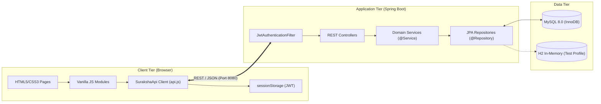

# Suraksha — Disaster Preparedness & Management Learning Platform

> **Important Educational Disclaimer**: Suraksha is an educational preparedness and training platform designed to teach disaster response and emergency safety procedures. It is **not** a real-time emergency dispatch or 911/112 broadcast system, and does **not** replace official municipal emergency services or certified paramedic training.
>
> **Deployment Status**: In strict adherence to project guidelines, this application has **not** been deployed to cloud hosting or production environments. It is configured for local development and testing.

---

## 📌 1. Project Overview & Problem Statement

### The Problem
During natural and human-induced hazards (such as earthquakes, residential or industrial fires, flash floods, and cyclones), casualties frequently occur not just from the hazard itself, but from panic and lack of situational awareness. Critical survival decisions—such as knowing whether to evacuate or take cover under heavy furniture, avoiding elevator usage during building fires, or performing basic CPR—must be learned and practiced *before* disaster strikes. Traditional safety brochures are static, rarely read, and fail to build decision-making reflexes.

### The Suraksha Solution
**Suraksha** (meaning *Protection / Safety*) is an interactive, full-stack educational web application designed for students, educators, and citizens. It transforms passive disaster guidelines into interactive, gamified learning modules:
* **Interactive Hazard Courses**: Structured lessons on Earthquakes, Fires, Floods, and Cyclones with clear "DOs" and "DON'Ts".
* **Cheating-Resistant Quizzes**: Randomized question sequences evaluated entirely server-side; correct answer keys and explanations remain hidden until submission.
* **Branching Virtual Mock Drills**: Interactive scenarios evaluating split-second survival decisions with dynamic score impacts and readiness ratings.
* **Instant First-Aid Quick Reference**: Accessible, search-enabled emergency treatment procedures (CPR, bleeding, burns, fractures).
* **Stateless Authenticated Dashboard**: Verified learner profile tracking course completions, quiz scores, and drill performance with strict cross-user data isolation.

---

## 🛠️ 2. Technology Stack & Rationale

| Layer / Technology | Justification & Architectural Role |
| :--- | :--- |
| **Frontend: HTML5, CSS3, Vanilla JavaScript** | Fast, responsive, accessible UI without frontend build tools or framework overhead. Uses semantic HTML, custom CSS properties (variables), Flexbox/Grid layouts, and modern ES6+ asynchronous Fetch APIs. |
| **Backend: Java 21 / 25, Spring Boot 3.3.5** | High-performance, type-safe REST API service using Spring Boot's production-ready embedded Tomcat server, constructor dependency injection, and centralized exception handling. |
| **Security: Spring Security 6 & JWT** | Stateless security architecture using HMAC-SHA signed JSON Web Tokens (JWT) for authentication and role-based access control (`ROLE_STUDENT`, `ROLE_ADMIN`). |
| **Password Encoding: BCrypt** | One-way salted cryptographic hashing (`strength = 10`) protecting user passwords against brute force and rainbow table attacks. |
| **Data Access: Spring Data JPA & Hibernate** | Object-Relational Mapping (ORM) mapping Java entities to MySQL tables, automating JPQL queries, dirty checking, and transaction boundaries. |
| **Database: MySQL 8.0 (InnoDB)** | Relational database providing ACID guarantees, foreign-key cascades, compound unique constraints, and optimized index lookups. |
| **Build & Test: Maven 3.9+, JUnit 5, Mockito** | Automated build lifecycle, 120-test multi-layered test pyramid (Unit, Repository Slice, MockMvc Security, and Node.js client tests). |

---

## 🏛️ 3. Architecture & Request Data Flow

Suraksha implements a decoupled, 3-tier modular architecture:



### End-to-End Request Flow Example (Course Fetching):
1. **User Interaction**: User visits `frontend/courses.html` and selects the "Fire" category filter.
2. **Client Dispatch**: `courses.js` calls `SurakshaApi.courses.getAll({ category: 'FIRE' })` in `frontend/js/api.js`.
3. **HTTP Transport**: Browser initiates `GET http://localhost:8080/api/courses?category=FIRE`.
4. **Security Filter**: `JwtAuthenticationFilter` inspects the request; public `GET /api/courses/**` endpoints are permitted without tokens.
5. **Controller**: `CourseController.getAllCourses()` receives the query parameters.
6. **Service**: `CourseService.getAllCourses()` invokes the repository.
7. **Database Query**: `CourseRepository` executes JPQL query `searchCourses('FIRE', null)` against MySQL.
8. **DTO Transformation**: Entities are mapped to `CourseSummaryDto` (including calculated lesson counts).
9. **Envelope Packaging**: Response is wrapped in `ApiResponse<List<CourseSummaryDto>>` and returned with HTTP 200.
10. **Client Rendering**: `api.js` unwraps the response payload; `courses.js` dynamically renders accessible course cards into the DOM.

---

## 🗄️ 4. Database Entities & Relationships

The relational schema comprises **14 tables** designed to Third Normal Form (3NF):

```text
users                     - Registered student and administrator accounts
roles                     - Security roles (ROLE_STUDENT, ROLE_ADMIN)
user_roles                - Join table mapping users to roles (Many-to-Many)
courses                   - Core hazard courses (slug, category, difficulty, summary)
lessons                   - Sequential learning units within a course (Many-to-One)
quizzes                   - Assessment attached to a course (One-to-One)
quiz_questions            - Multiple-choice questions for a quiz (Many-to-One)
quiz_options              - Answer choices with server-side is_correct flag (Many-to-One)
quiz_attempts             - Historical student score logs and pass/fail status (Many-to-One)
drill_scenarios           - Virtual emergency mock scenarios (Many-to-One with course)
drill_steps               - Decision steps within a scenario (Many-to-One)
drill_choices             - Selectable choices with score impact and next_step_id branching
drill_attempts            - Completed drill scores and readiness ratings (Many-to-One)
user_lesson_progress      - Idempotent lesson completion records (Unique user_id + lesson_id)
contact_messages          - User inquiries and feedback with status tracking
```

---

## 🔐 5. Authentication & Authorization Policies

| Endpoint Path | Method | Access Level | Description |
| :--- | :---: | :---: | :--- |
| `/api/auth/register` | `POST` | Public | Registers a new student account, hashes password via BCrypt, assigns `ROLE_STUDENT`. |
| `/api/auth/login` | `POST` | Public | Authenticates credentials and returns signed JWT string with user profile. |
| `/api/auth/me` | `GET` | Authenticated | Returns profile of the current authenticated user from JWT claims. |
| `/api/courses/**` | `GET` | Public | Lists educational courses and detailed lesson content. |
| `/api/quizzes/{id}` | `GET` | Public | Returns quiz questions and options with correct answer keys stripped. |
| `/api/quizzes/{id}/submit` | `POST` | Authenticated | Evaluates student answers, logs a `QuizAttempt`, and returns educational debrief. |
| `/api/drills/**` | `GET` | Public | Returns mock drill scenario graphs and decision trees. |
| `/api/drills/{id}/submit` | `POST` | Authenticated | Scores scenario choices, verifies choice belonging, and logs a `DrillAttempt`. |
| `/api/progress/**` | `GET`, `POST` | Authenticated | Idempotent lesson progress tracking and personalized dashboard summary. |
| `/api/contact` | `POST` | Public | Submits validated user inquiries and feedback. |
| `/api/health` | `GET` | Public | Service health probe returning database connectivity status. |

---

## 🚀 6. Local Setup & Execution Guide

### Prerequisites
* **Java Development Kit (JDK)**: Version 17+ or 21/25 installed and available on PATH (`java -version`).
* **Apache Maven**: Version 3.8+ installed (`mvn -version`).
* **Node.js**: Version 18+ (used strictly for executing frontend client tests; not required for runtime).
* **MySQL 8.0**: Local MySQL service installed and running on port `3306`.
* **Web Browser**: Any modern browser (Google Chrome, Microsoft Edge, Mozilla Firefox).

---

### Step 1: Database Initialization (Optional for Live MySQL)
If connecting to a live local MySQL instance, execute the SQL schema in MySQL Workbench or CLI:
```sql
SOURCE database/schema.sql;
SOURCE database/data.sql;
```

---

### Step 2: Configure & Start Backend
Navigate to the `backend/` directory:
```powershell
cd backend
```
*(Optional)* Configure database credentials via environment variables if different from defaults:
```powershell
$env:DB_USERNAME="root"
$env:DB_PASSWORD="your_mysql_password"
```
Run the Spring Boot application:
```powershell
mvn spring-boot:run
```
The REST API will initialize on `http://localhost:8080`. Verify the server is running by opening `http://localhost:8080/api/health` in your browser.

---

### Step 3: Run the Frontend
Because the frontend is built entirely in vanilla HTML/CSS/JavaScript without build tools, it can be served using any local static web server.
Using Python:
```powershell
cd frontend
python -m http.server 5500
```
Or using Node's `npx serve`:
```powershell
cd frontend
npx serve -l 5500
```
Open `http://localhost:5500` in your web browser.

---

## 🧪 7. Automated Test Execution

The platform is verified by **120 automated tests** across all layers.

### Run All Backend Tests (106 Tests)
```powershell
cd backend
mvn clean test
```

### Package Production JAR
```powershell
cd backend
mvn package -DskipTests
# Generates backend/target/suraksha-backend-0.0.1-SNAPSHOT.jar
```

### Run Frontend Automated Client Tests (14 Tests)
```powershell
# From project root
node frontend/test/api.test.js
```

### Interactive In-Browser Test Runner
Open `frontend/test/runner.html` in your web browser to run the API client tests interactively.

---

## ⚠️ 8. Known Limitations & Honest Status Report

1. **MySQL Verification Status**:
   - The Windows service `MySQL80` is active and running on the local host.
   - All 106 automated backend tests execute against an in-memory H2 database running in MySQL compatibility mode (`MODE=MySQL;DATABASE_TO_LOWER=TRUE`).
   - Testing against H2 proves JPA syntax, entity mappings, compound unique constraints, and JPQL queries. However, it does not replace staging verification against a live MySQL 8.0 server with production credentials.
2. **No Real-Time Push Notifications**:
   - WebSockets or Server-Sent Events (SSE) are not currently implemented; dashboard and course updates require page reload.
3. **Session Scope**:
   - JWT tokens are stored in `sessionStorage` for security hygiene, meaning opening a new tab requires signing in again.
4. **No Deployment**:
   - The application has not been deployed to AWS, Docker, or Kubernetes per project constraints.

---

## 🗺️ Milestone Roadmap Status

| Milestone | Description | Status |
| :--- | :--- | :---: |
| **Milestone 1** | Requirements & System Architecture Specification | ✅ **Completed** |
| **Milestone 2** | Frontend Foundation (Base CSS, Layout, Home, About, Contact) | ✅ **Completed** |
| **Milestone 3** | Frontend Learning Pages (Catalogue, Lessons, Quizzes, Drills, First Aid, Auth) | ✅ **Completed** |
| **Milestone 4** | Database Design (ER Schema, Relationships, Seed SQL) | ✅ **Completed** |
| **Milestone 5** | Spring Boot Foundation (Maven project, JPA Entities, DTOs, Repositories, Services) | ✅ **Completed** |
| **Milestone 6** | Authentication & Authorization (Spring Security, BCrypt, Token/Session, Roles) | ✅ **Completed** |
| **Milestone 7** | Core REST APIs (Courses, Quizzes, Mock Drills, Contact, Progress Tracking) | ✅ **Completed** |
| **Milestone 8** | Frontend-Backend Integration (Centralized Fetch Client, JWT Auth, Quizzes, Drills, Dashboard) | ✅ **Completed** |
| **Milestone 9** | Testing & Reliability (120 Automated Tests, Unit, Slice, MockMvc, Security, & Client) | ✅ **Completed** |
| **Milestone 10** | Final Review, Audit & Technical Interview Learning Guide | ✅ **Completed** |

---

## 📖 9. Learning & Technical Interview Resources

* **Technical Interview Guide**: [`docs/TECHNICAL_INTERVIEW_GUIDE.md`](file:///d:/Projects/Suraksha%20Disaster%20Preparedness%20Project/docs/TECHNICAL_INTERVIEW_GUIDE.md) (Detailed breakdown, 32 technical Q&As with code references, 60s/3m pitches, resume bullets).
* **Final Project Audit**: [`docs/FINAL_PROJECT_REVIEW.md`](file:///d:/Projects/Suraksha%20Disaster%20Preparedness%20Project/docs/FINAL_PROJECT_REVIEW.md) (Detailed test logs, defect analysis, security review, and reading list).
* **Testing Guide**: [`docs/TESTING_GUIDE.md`](file:///d:/Projects/Suraksha%20Disaster%20Preparedness%20Project/docs/TESTING_GUIDE.md) (Testing pyramid structure and execution logs).
* **API Documentation**: [`docs/API_DOCUMENTATION.md`](file:///d:/Projects/Suraksha%20Disaster%20Preparedness%20Project/docs/API_DOCUMENTATION.md) (REST contracts and payload examples).
* **Database Design**: [`docs/DATABASE_DESIGN.md`](file:///d:/Projects/Suraksha%20Disaster%20Preparedness%20Project/docs/DATABASE_DESIGN.md) (Entity relationship specifications and constraints).
