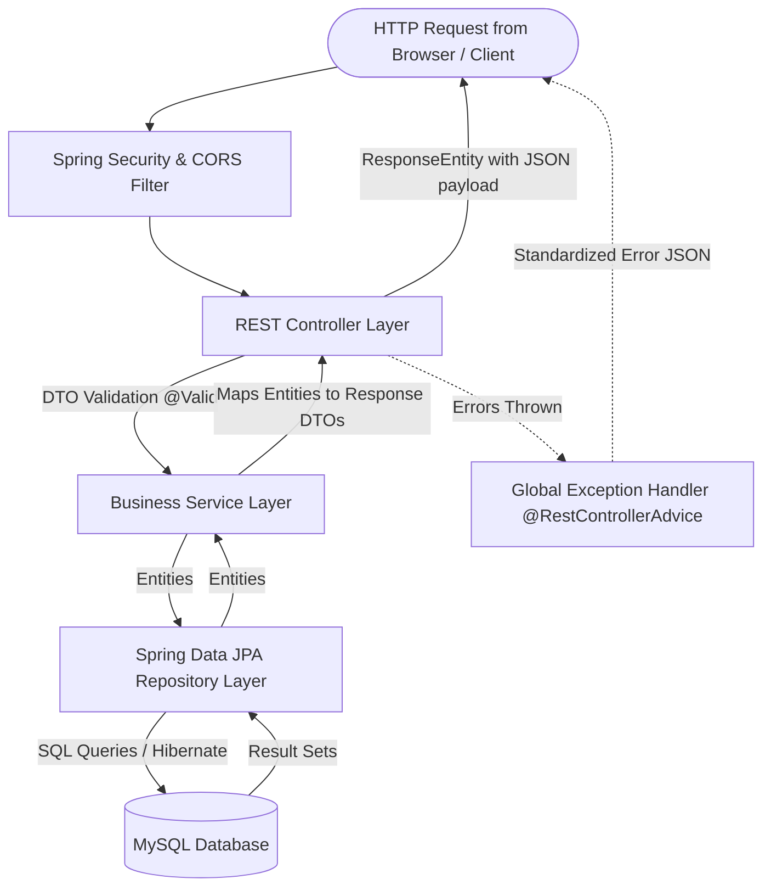
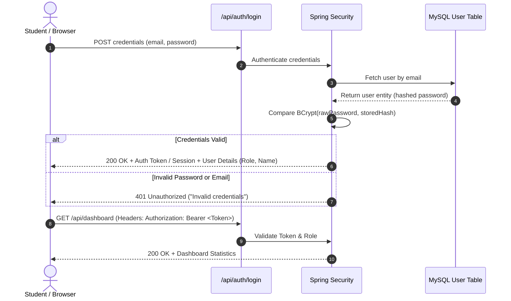

# Suraksha: System Architecture & Design Specification

This document details the architectural design of the **Suraksha** disaster preparedness platform. It serves as a technical reference and educational guide explaining how each layer of the application is constructed, why specific architectural choices were made, and how data flows through the system.

---

## 1. High-Level Architectural Pattern

Suraksha adheres to a **Decoupled Client-Server Architecture** utilizing **RESTful Web APIs**.

```mermaid
flowchart LR
    subgraph Client ["Client Tier (Browser)"]
        UI["Vanilla HTML5 & CSS3"]
        JS["Vanilla JS Engine (ES6+)"]
        Fetch["Fetch API Client"]
        UI --- JS
        JS --- Fetch
    end

    subgraph Transport ["Network Layer"]
        HTTP["HTTP / HTTPS (JSON Payloads)"]
    end

    subgraph Server ["Server Tier (Spring Boot 3)"]
        Security["Spring Security Filter Chain"]
        Controller["REST Controllers"]
        Service["Business Service Layer"]
        Repo["Spring Data JPA Repositories"]
        Security --> Controller
        Controller --> Service
        Service --> Repo
    end

    subgraph Data ["Database Tier"]
        MySQL[(MySQL 8.0 Database)]
        Repo --- MySQL
    end

    Fetch <-->|JSON Requests & Responses| HTTP
    HTTP <--> Security
```



### Why Decoupled Vanilla Frontend + Spring Boot?
1. **Separation of Concerns**: The user interface does not depend on server-side template rendering (like JSP or Thymeleaf). The frontend acts purely as a presentation layer consuming JSON data.
2. **Framework-Free Simplicity**: Vanilla HTML5, CSS3, and JavaScript provide blazing performance, zero dependency rot, no node_modules overhead, and complete transparency into standard web platform primitives (DOM, Events, Fetch API).
3. **Industry-Standard Layered Backend**: Spring Boot provides battle-tested dependency injection, enterprise-grade security, and robust transaction management.

---

## 2. Backend Layered Architecture

To ensure code maintainability, testability, and clean responsibility separation, the backend follows a strict **Layered Architecture**:



### Layer Responsibilities Explained in Simple Terms:

1. **Controller Layer (`com.suraksha.controller`)**:
   * **Role**: The "receptionist" of the backend.
   * **What it does**: Listens to HTTP endpoints (e.g. `GET /api/courses`, `POST /api/quizzes/1/submit`), parses HTTP parameters/bodies, triggers validation, and delegates work to the Service layer.
   * **Rule**: Controllers must remain **thin**—they should never contain business rules, database queries, or complex logic.

2. **DTO Layer (`com.suraksha.dto`)**:
   * **Role**: Data Transfer Objects.
   * **What it does**: Defines the precise shape of data entering or leaving the API.
   * **Why it exists**: Exposing database entities directly can cause security vulnerabilities (over-posting / mass assignment), infinite JSON recursion loops (due to bidirectional JPA relationships), and tight coupling between database schemas and client contracts.

3. **Service Layer (`com.suraksha.service`)**:
   * **Role**: The "brain" of the backend.
   * **What it does**: Implements business rules (e.g., verifying quiz answers against answer keys, calculating safety readiness percentages, hashing passwords, managing transactions with `@Transactional`).
   * **Rule**: Business decisions reside strictly here, making them easily unit-testable without needing HTTP or database servers running.

4. **Repository Layer (`com.suraksha.repository`)**:
   * **Role**: The "librarian" communicating with the database.
   * **What it does**: Extends Spring Data JPA's `JpaRepository<T, ID>`, providing built-in methods (`save()`, `findById()`, `findAll()`, `delete()`) and derived queries (e.g., `findByCategory()`, `findByEmail()`) without writing boilerplate SQL.

5. **Entity Layer (`com.suraksha.entity`)**:
   * **Role**: Object-Relational Mapping (ORM) models.
   * **What it does**: Java classes annotated with `@Entity` that map directly to MySQL tables. Fields map to table columns, and annotations like `@ManyToOne` and `@OneToMany` model relational foreign keys.

6. **Exception Handling Layer (`com.suraksha.exception`)**:
   * **Role**: The safety net.
   * **What it does**: A central class annotated with `@RestControllerAdvice` that catches unhandled exceptions (such as `ResourceNotFoundException`, `BadCredentialsException`, `MethodArgumentNotValidException`) and transforms them into a clean, predictable JSON response structure.

---

## 3. Standard API Response Structure

Every REST endpoint in Suraksha returns a uniform response wrapper to ensure consistent client-side parsing:

### Successful Response Format:
```json
{
  "success": true,
  "message": "Courses retrieved successfully",
  "data": [ ... ],
  "timestamp": "2026-10-18T10:15:30Z"
}
```

### Error Response Format:
```json
{
  "success": false,
  "message": "Validation failed for one or more fields",
  "errors": [
    "Email format is invalid",
    "Password must be at least 8 characters"
  ],
  "path": "/api/auth/register",
  "timestamp": "2026-10-18T10:15:30Z"
}
```

---

## 4. Security & Authentication Architecture



### Key Security Decisions:
1. **Password Hashing**: Always hashed using `BCryptPasswordEncoder` with a strength factor of 10. Plaintext passwords are never logged, stored, or returned.
2. **Token-based Authentication**: A signed token (or standard bearer authorization) allows our decoupled vanilla JS frontend to securely communicate with the backend across localhost ports without complex cookie-domain sharing issues.
3. **Role-Based Access Control (RBAC)**:
   * `ROLE_STUDENT`: Standard learner who can enroll, complete lessons, submit quizzes, and view their dashboard.
   * `ROLE_ADMIN`: Educational coordinator who can create/modify courses, add quiz questions, and view feedback submissions.
4. **CORS (Cross-Origin Resource Sharing)**:
   * Explicitly configured to allow local frontend origins (e.g. `http://127.0.0.1:5500`, `http://localhost:3000`, `http://localhost:8080`) while rejecting arbitrary external origins.

---

## 5. Frontend Architecture & Modular Organization

The frontend uses standard browser-native capabilities organized cleanly:

```text
frontend/
├── index.html, courses.html, ...  # Semantic page structures
├── css/
│   ├── variables.css              # Design tokens (colors, typography, spacing)
│   ├── base.css                   # Resets, global typography, container styles
│   ├── components.css             # Buttons, cards, alert banners, modal dialogs
│   └── responsive.css             # Media queries for mobile & tablet screens
└── js/
    ├── config.js                  # API base URL and environment constants
    ├── api.js                     # Generic fetch wrapper with auth header injection & error handling
    ├── auth.js                    # Login, registration, token persistence, logout logic
    └── app.js                     # Page-specific dynamic rendering & interactive handlers
```

### Why this frontend structure?
* **Zero build step**: No webpack, vite, or npm commands required to view or test the frontend. Simply open `index.html` in a web browser or use a simple local HTTP server.
* **Separation of presentation and logic**: Clean stylesheet split prevents monolithic unmaintainable CSS files.
* **Reusable Fetch wrapper**: `api.js` encapsulates standard HTTP headers, error response checking, and loading states, keeping page scripts uncluttered.
