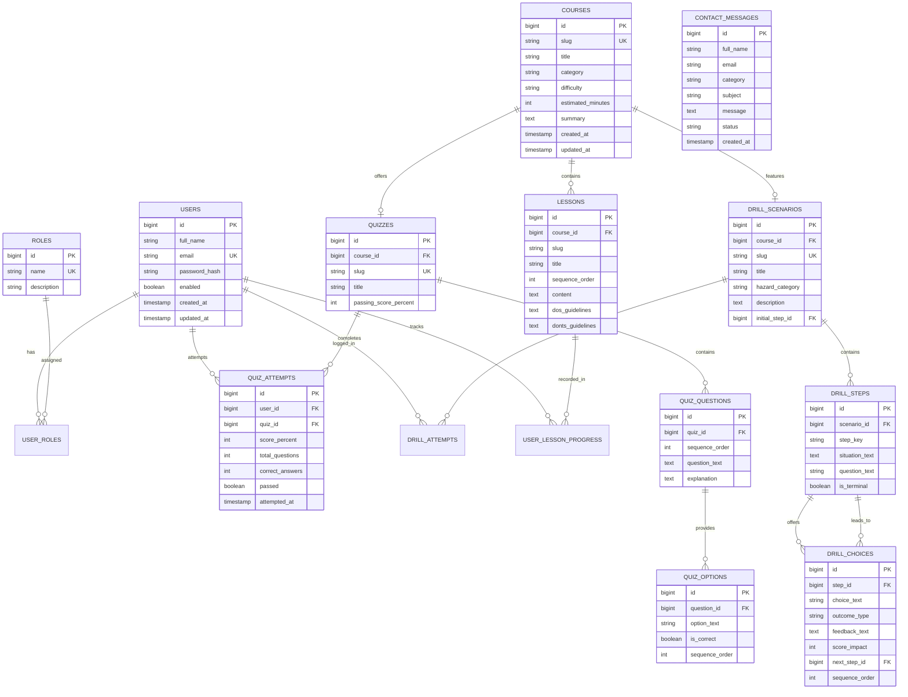

# Suraksha: Relational Database Design Specification

This document details the relational database architecture for **Suraksha**. It defines table schemas, foreign key relationships, constraints, indexing strategies, and Spring Data JPA mapping considerations.

---

## 1. Design Principles & Architecture

The database design adheres to the following principles:

1. **Third Normal Form (3NF)**:
   * Redundant data is eliminated. Every non-primary-key column depends solely on the primary key.
   * Separate tables model distinct domain entities: Users, Roles, Courses, Lessons, Quizzes, Questions, Options, Drill Scenarios, Drill Steps, Drill Choices, Progress, and Contact Inquiries.
2. **Surrogate Primary Keys**:
   * Every table utilizes a numeric `BIGINT AUTO_INCREMENT` primary key named `id`.
   * Maps cleanly to Java's `Long` type and Spring Data JPA's `@GeneratedValue(strategy = GenerationType.IDENTITY)`.
3. **Natural Business Keys with Unique Constraints**:
   * Entities that have natural unique identifiers (such as user emails, course slugs, and scenario keys) have `UNIQUE` constraints to guarantee database-level integrity.
4. **Security by Design**:
   * **Passwords**: Plaintext passwords are never stored. The `password_hash` column holds standard 60-character BCrypt hashes (`$2a$10$...`).
   * **Quiz Correctness**: Correct answers are stored strictly in the database (`is_correct` column on `quiz_options`). Public course and quiz endpoints never leak this column to the browser.
5. **No Circular Foreign Keys**:
   * Rather than placing a `correct_option_id` foreign key on `quiz_questions` (which causes a circular dependency when inserting questions before options), each `quiz_option` has an `is_correct BOOLEAN` flag.

---

## 2. Entity-Relationship (ER) Diagram

---

## 3. Detailed Table Specifications

### A. Authentication & Access Control

#### `users`
Represents registered learners, educators, and administrators.
* `id` (`BIGINT`, `AUTO_INCREMENT`, `PRIMARY KEY`): Unique user identifier.
* `full_name` (`VARCHAR(100)`, `NOT NULL`): Learner's display name.
* `email` (`VARCHAR(150)`, `NOT NULL`, `UNIQUE`): Login credential; indexed for fast authentication lookup.
* `password_hash` (`VARCHAR(255)`, `NOT NULL`): BCrypt salted password hash. Plaintext is never stored.
* `enabled` (`BOOLEAN`, `NOT NULL`, `DEFAULT TRUE`): Account activation flag for Spring Security.
* `created_at` (`TIMESTAMP`, `DEFAULT CURRENT_TIMESTAMP`): Account creation time.
* `updated_at` (`TIMESTAMP`, `DEFAULT CURRENT_TIMESTAMP ON UPDATE CURRENT_TIMESTAMP`): Last profile modification.

#### `roles`
Stores authorization authorities.
* `id` (`BIGINT`, `AUTO_INCREMENT`, `PRIMARY KEY`)
* `name` (`VARCHAR(50)`, `NOT NULL`, `UNIQUE`): Role authority string (e.g. `ROLE_STUDENT`, `ROLE_ADMIN`, `ROLE_TEACHER`).
* `description` (`VARCHAR(255)`): Human-readable explanation of permissions.

#### `user_roles`
Join table implementing a many-to-many relationship between users and roles.
* `user_id` (`BIGINT`, `NOT NULL`, `FOREIGN KEY` -> `users.id` `ON DELETE CASCADE`)
* `role_id` (`BIGINT`, `NOT NULL`, `FOREIGN KEY` -> `roles.id` `ON DELETE CASCADE`)
* `PRIMARY KEY (user_id, role_id)`

---

### B. Educational Courses & Lessons

#### `courses`
Stores disaster preparedness courses.
* `id` (`BIGINT`, `AUTO_INCREMENT`, `PRIMARY KEY`)
* `slug` (`VARCHAR(100)`, `NOT NULL`, `UNIQUE`): URL-friendly identifier (e.g., `earthquake-101`, `flood-101`).
* `title` (`VARCHAR(200)`, `NOT NULL`): Course title.
* `category` (`VARCHAR(50)`, `NOT NULL`): Hazard category (`EARTHQUAKE`, `FLOOD`, `FIRE`, `CYCLONE`).
* `difficulty` (`VARCHAR(30)`, `NOT NULL`, `DEFAULT 'BEGINNER'`): `BEGINNER`, `INTERMEDIATE`, `ADVANCED`.
* `estimated_minutes` (`INT`, `NOT NULL`, `DEFAULT 20`): Approximate time to complete.
* `summary` (`TEXT`, `NOT NULL`): Overview paragraph for cards and previews.
* `created_at` & `updated_at` (`TIMESTAMP`).

#### `lessons`
Individual learning modules within a course.
* `id` (`BIGINT`, `AUTO_INCREMENT`, `PRIMARY KEY`)
* `course_id` (`BIGINT`, `NOT NULL`, `FOREIGN KEY` -> `courses.id` `ON DELETE CASCADE`)
* `slug` (`VARCHAR(100)`, `NOT NULL`): Module slug within course (e.g. `eq-lesson-1`).
* `title` (`VARCHAR(200)`, `NOT NULL`): Module headline.
* `sequence_order` (`INT`, `NOT NULL`): Display order (1, 2, 3...).
* `content` (`MEDIUMTEXT`, `NOT NULL`): Formatted educational reading material.
* `dos_guidelines` (`TEXT`): Line-delimited or JSON list of life-saving DOs.
* `donts_guidelines` (`TEXT`): Line-delimited or JSON list of critical DON'Ts.
* Constraints: `UNIQUE (course_id, sequence_order)` and `UNIQUE (course_id, slug)`.

---

### C. Quizzes, Questions & Assessment Attempts

#### `quizzes`
Assessment metadata associated with courses.
* `id` (`BIGINT`, `AUTO_INCREMENT`, `PRIMARY KEY`)
* `course_id` (`BIGINT`, `NOT NULL`, `UNIQUE`, `FOREIGN KEY` -> `courses.id` `ON DELETE CASCADE`)
* `slug` (`VARCHAR(100)`, `NOT NULL`, `UNIQUE`): Quiz slug (e.g. `quiz-earthquake`).
* `title` (`VARCHAR(200)`, `NOT NULL`)
* `passing_score_percent` (`INT`, `NOT NULL`, `DEFAULT 75`): Threshold required to pass.

#### `quiz_questions`
Multiple-choice questions within a quiz.
* `id` (`BIGINT`, `AUTO_INCREMENT`, `PRIMARY KEY`)
* `quiz_id` (`BIGINT`, `NOT NULL`, `FOREIGN KEY` -> `quizzes.id` `ON DELETE CASCADE`)
* `sequence_order` (`INT`, `NOT NULL`)
* `question_text` (`TEXT`, `NOT NULL`)
* `explanation` (`TEXT`, `NOT NULL`): Comprehensive safety explanation returned after submission.
* Constraint: `UNIQUE (quiz_id, sequence_order)`.

#### `quiz_options`
Selectable options for each question.
* `id` (`BIGINT`, `AUTO_INCREMENT`, `PRIMARY KEY`)
* `question_id` (`BIGINT`, `NOT NULL`, `FOREIGN KEY` -> `quiz_questions.id` `ON DELETE CASCADE`)
* `option_text` (`VARCHAR(500)`, `NOT NULL`)
* `is_correct` (`BOOLEAN`, `NOT NULL`, `DEFAULT FALSE`): Evaluated on backend only.
* `sequence_order` (`INT`, `NOT NULL`, `DEFAULT 1`)

#### `quiz_attempts`
Historical log of student quiz submissions.
* `id` (`BIGINT`, `AUTO_INCREMENT`, `PRIMARY KEY`)
* `user_id` (`BIGINT`, `NOT NULL`, `FOREIGN KEY` -> `users.id` `ON DELETE CASCADE`)
* `quiz_id` (`BIGINT`, `NOT NULL`, `FOREIGN KEY` -> `quizzes.id` `ON DELETE CASCADE`)
* `score_percent` (`INT`, `NOT NULL`): Computed percentage.
* `total_questions` (`INT`, `NOT NULL`)
* `correct_answers` (`INT`, `NOT NULL`)
* `passed` (`BOOLEAN`, `NOT NULL`)
* `attempted_at` (`TIMESTAMP`, `DEFAULT CURRENT_TIMESTAMP`)
* Index: `idx_user_quiz (user_id, quiz_id)` for quick learner history lookups.

---

### D. Virtual Mock Drills & Branching Decision Trees

#### `drill_scenarios`
Simulated emergency drill scenarios.
* `id` (`BIGINT`, `AUTO_INCREMENT`, `PRIMARY KEY`)
* `course_id` (`BIGINT`, `NULL`, `FOREIGN KEY` -> `courses.id` `ON DELETE SET NULL`)
* `slug` (`VARCHAR(100)`, `NOT NULL`, `UNIQUE`): e.g. `drill-earthquake`.
* `title` (`VARCHAR(200)`, `NOT NULL`)
* `hazard_category` (`VARCHAR(50)`, `NOT NULL`)
* `description` (`TEXT`, `NOT NULL`)
* `initial_step_id` (`BIGINT`, `NULL`): Points to the starting step.

#### `drill_steps`
Individual situations within a simulation scenario.
* `id` (`BIGINT`, `AUTO_INCREMENT`, `PRIMARY KEY`)
* `scenario_id` (`BIGINT`, `NOT NULL`, `FOREIGN KEY` -> `drill_scenarios.id` `ON DELETE CASCADE`)
* `step_key` (`VARCHAR(50)`, `NOT NULL`): e.g. `step-1`, `step-2`, `step-finish`.
* `situation_text` (`TEXT`, `NOT NULL`)
* `question_text` (`VARCHAR(500)`, `NULL`)
* `is_terminal` (`BOOLEAN`, `NOT NULL`, `DEFAULT FALSE`): True if this step concludes the simulation.
* Constraint: `UNIQUE (scenario_id, step_key)`.

#### `drill_choices`
Decisions available at a particular drill step.
* `id` (`BIGINT`, `AUTO_INCREMENT`, `PRIMARY KEY`)
* `step_id` (`BIGINT`, `NOT NULL`, `FOREIGN KEY` -> `drill_steps.id` `ON DELETE CASCADE`)
* `choice_text` (`VARCHAR(500)`, `NOT NULL`)
* `outcome_type` (`VARCHAR(20)`, `NOT NULL`): `SAFE`, `DANGER`, `NEUTRAL`.
* `feedback_text` (`TEXT`, `NOT NULL`): Explains consequence and survival physics.
* `score_impact` (`INT`, `NOT NULL`, `DEFAULT 0`): Points awarded or deducted.
* `next_step_id` (`BIGINT`, `NULL`, `FOREIGN KEY` -> `drill_steps.id` `ON DELETE SET NULL`): The subsequent step triggered.
* `sequence_order` (`INT`, `NOT NULL`, `DEFAULT 1`)

#### `drill_attempts`
Records learner simulation outcomes.
* `id` (`BIGINT`, `AUTO_INCREMENT`, `PRIMARY KEY`)
* `user_id` (`BIGINT`, `NOT NULL`, `FOREIGN KEY` -> `users.id` `ON DELETE CASCADE`)
* `scenario_id` (`BIGINT`, `NOT NULL`, `FOREIGN KEY` -> `drill_scenarios.id` `ON DELETE CASCADE`)
* `total_score` (`INT`, `NOT NULL`, `DEFAULT 0`)
* `rating_label` (`VARCHAR(50)`, `NOT NULL`): e.g. `Preparedness Master`.
* `completed_at` (`TIMESTAMP`, `DEFAULT CURRENT_TIMESTAMP`)

---

### E. User Progress & Community Contact

#### `user_lesson_progress`
Tracks which lessons a student has completed.
* `id` (`BIGINT`, `AUTO_INCREMENT`, `PRIMARY KEY`)
* `user_id` (`BIGINT`, `NOT NULL`, `FOREIGN KEY` -> `users.id` `ON DELETE CASCADE`)
* `lesson_id` (`BIGINT`, `NOT NULL`, `FOREIGN KEY` -> `lessons.id` `ON DELETE CASCADE`)
* `completed` (`BOOLEAN`, `NOT NULL`, `DEFAULT TRUE`)
* `completed_at` (`TIMESTAMP`, `DEFAULT CURRENT_TIMESTAMP`)
* Constraint: `UNIQUE (user_id, lesson_id)` ensures idempotent progress updates.

#### `contact_messages`
Stores contact inquiries and feedback submissions.
* `id` (`BIGINT`, `AUTO_INCREMENT`, `PRIMARY KEY`)
* `full_name` (`VARCHAR(100)`, `NOT NULL`)
* `email` (`VARCHAR(150)`, `NOT NULL`)
* `category` (`VARCHAR(50)`, `NOT NULL`)
* `subject` (`VARCHAR(200)`, `NOT NULL`)
* `message` (`TEXT`, `NOT NULL`)
* `status` (`VARCHAR(20)`, `NOT NULL`, `DEFAULT 'NEW'`): `NEW`, `READ`, `RESOLVED`.
* `created_at` (`TIMESTAMP`, `DEFAULT CURRENT_TIMESTAMP`)

---

## 4. Key Architectural Decisions Explained Simply

1. **Why Separate Roles Table instead of a simple VARCHAR column?**
   * While storing `role VARCHAR(50)` on `users` is simpler, a many-to-many `user_roles` structure cleanly supports future requirements where a user might be both an `INSTRUCTOR` and an `ADMIN`. Spring Security natively consumes `Set<Role>` through `@ManyToMany` relationships.
2. **How Branching Mock Drills are Modeled**:
   * Instead of hardcoding steps in JSON, each step is an individual row in `drill_steps`, and each decision is a row in `drill_choices` pointing to `next_step_id`. This creates an **Adjacency List Graph** in SQL, allowing instructors or admins to add, branch, or reorder simulation steps without modifying code.
3. **Repeated Quiz Attempts**:
   * Storing individual submissions in `quiz_attempts` allows learners to practice quizzes multiple times. The dashboard can query either their latest score or highest score using simple SQL aggregation (`MAX(score_percent)`).
