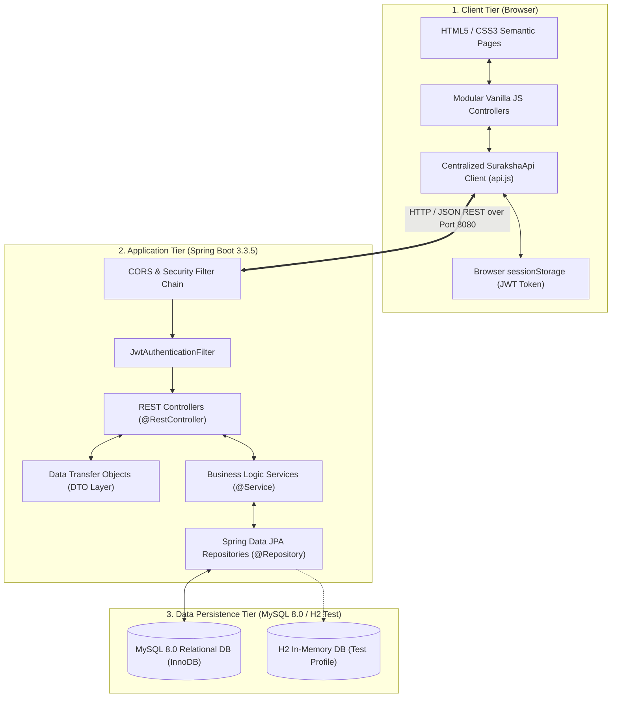
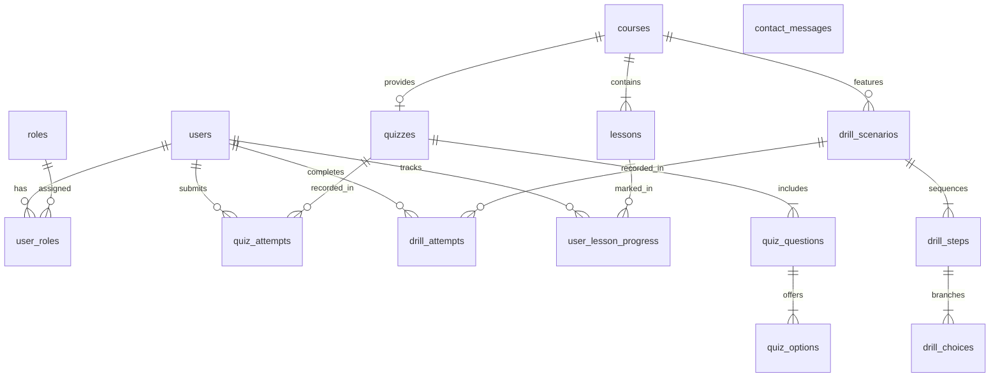
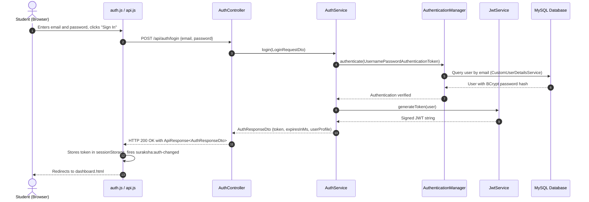

# Suraksha — Comprehensive Technical Interview & Architecture Guide
### Prepared for Full-Stack Software Engineering Interviews (ECE / Fresher / Junior Developer)

---

## 🧭 Document Overview & Purpose

This guide is designed to help you confidently explain the **Suraksha Disaster Preparedness & Management Platform** in technical interviews. It translates the real source code, design decisions, database schemas, and architectural patterns of the Suraksha project into clear, beginner-friendly explanations with simple analogies and concrete file citations.

---

## 📑 Table of Contents
1. [A. Project Overview & Scope](#a-project-overview--scope)
2. [B. System Architecture & Layer Separation](#b-system-architecture--layer-separation)
3. [C. Technology Choices & Justifications](#c-technology-choices--justifications)
4. [D. Frontend Implementation](#d-frontend-implementation)
5. [E. Backend Implementation](#e-backend-implementation)
6. [F. Database Design & JPA Mappings](#f-database-design--jpa-mappings)
7. [G. Authentication & Authorization](#g-authentication--authorization)
8. [H. Complete Step-by-Step Data Flows](#h-complete-step-by-step-data-flows)
9. [I. Testing Strategy & Verification](#i-testing-strategy--verification)
10. [J. Engineering Challenges & Bug Fixes](#j-engineering-challenges--bug-fixes)
11. [K. Limitations & Future Roadmap](#k-limitations--future-roadmap)
12. [L. 32 Project-Specific Technical Interview Q&As](#l-32-project-specific-technical-interview-qas)
13. [M. Elevator Pitches (60-Second & 3-Minute)](#m-elevator-pitches-60-second--3-minute)
14. [N. Verified Resume Bullet Points](#n-verified-resume-bullet-points)

---

## A. Project Overview & Scope

### 1. Problem Statement
Disaster management in many communities and educational institutions suffers from a major gap: awareness information is usually scattered across PDF brochures or static leaflets. People lack interactive ways to practice split-second decisions before a crisis occurs, such as knowing whether to take stairs or elevators during an earthquake, or how to treat a second-degree burn.

### 2. What Suraksha Is
**Suraksha** (meaning *Protection / Safety* in Hindi and Sanskrit) is a full-stack educational learning platform that trains students, teachers, and citizens in disaster preparedness, safety protocols, and emergency first aid.

### 3. Target Users
* **Students & Young Citizens**: Want engaging, structured learning modules, gamified quizzes, and realistic scenario drills.
* **Teachers & School Administrators**: Want standardized safety curricula for hazard awareness (earthquakes, floods, fires, cyclones).
* **General Public**: Need rapid, accessible reference protocols for emergency first aid.

### 4. Core Features Implemented
1. **Interactive Course Catalogue**: Filter hazards by category (`EARTHQUAKE`, `FIRE`, `FLOOD`, `CYCLONE`) with real-time keyword search.
2. **Structured Lesson Viewer**: Step-by-step sequential learning modules with categorized "DOs and DON'Ts" and idempotent completion tracking.
3. **Cheating-Resistant Interactive Quizzes**: Quizzes where questions and options are public, but correct answers and explanations remain strictly on the server until submission.
4. **Branching Virtual Mock Drills**: Interactive scenarios where choices have positive and negative score impacts, dynamically routing learners to terminal evaluations and readiness ratings (`Preparedness Master`, `Safety Conscious`, etc.).
5. **Verified First-Aid Reference**: Responsive, instant-search emergency medical guides (CPR, severe bleeding, burns, fractures, choking).
6. **Stateless JWT Authentication & RBAC**: Secure user registration, BCrypt password hashing, token generation, and role management (`ROLE_STUDENT`, `ROLE_ADMIN`).
7. **Personalized Learner Dashboard**: Complete historical view of course completion percentages, quiz scores, and drill attempts with strict cross-user data isolation.
8. **Contact & Feedback Service**: Validated inquiries stored in MySQL with status tracking (`NEW`).

### 5. Project Scope & Educational Disclaimer
> [!IMPORTANT]
> Suraksha is an **educational preparedness tool**, not a real-time emergency dispatch or 911/112 alert broadcaster. It does not replace certified paramedics or municipal emergency response teams.

---

## B. System Architecture & Layer Separation

Suraksha follows a classical **Decoupled 3-Tier Layered Architecture**:



### Why Layer Separation Matters (Beginner Analogy)
Think of a restaurant:
* **The Customer (Client Tier / Frontend)**: Sits at the table, views the menu, and chooses food. They never enter the kitchen directly.
* **The Waiter (Controller / DTO)**: Takes the customer's order, validates that the items exist, brings it to the kitchen, and delivers the cooked meal in a clean plate.
* **The Chef (Service Layer)**: Applies business rules—recipes, cooking times, quality checks.
* **The Pantry Clerk (Repository Layer)**: Fetches raw ingredients from storage shelves.
* **The Pantry (Database Tier)**: Organizes ingredients systematically.

If the restaurant decides to reorganize its pantry (e.g. switching from MySQL to PostgreSQL), the customer and waiter don't change at all. Only the pantry clerk changes how ingredients are retrieved.

---

## C. Technology Choices & Justifications

| Technology | Role | Why It Was Chosen Over Alternatives |
| :--- | :--- | :--- |
| **Vanilla HTML5, CSS3, JavaScript** | Frontend UI | **No build step required**, zero dependency vulnerabilities, runs natively in any browser, sub-second load times, and teaches foundational DOM/Web APIs without framework abstractions (React/Angular). |
| **Java 21 / 25** | Programming Language | Strong type safety, high concurrency performance, long-term enterprise ecosystem, and modern features (records, pattern matching, enhanced switch). |
| **Spring Boot 3.3.5** | Backend Framework | Rapid configuration, production-ready embedded Tomcat server, rich ecosystem (Spring Security, Spring Data), and widespread enterprise industry standard. |
| **Spring Data JPA & Hibernate** | ORM / Persistence | Eliminates boilerplate JDBC SQL; automatically translates Java object operations into optimized SQL queries; provides automatic dirty checking and relationship cascading. |
| **MySQL 8.0** | Relational Database | ACID-compliant transaction engine (InnoDB), native support for foreign key cascades, unique constraints, and robust indexing. |
| **Spring Security 6 & JWT** | Security & Auth | **Stateless scalability**. The server does not store session IDs in memory; every request carries its own cryptographically signed JSON Web Token. |
| **BCrypt Password Encoder** | Cryptographic Hashing | One-way hashing with an internal salt and configurable cost factor (`strength = 10`), protecting stored passwords against rainbow tables and brute-force attacks. |
| **Apache Maven** | Build & Dependency Management | Declarative `pom.xml`, automated lifecycle phases (`compile`, `test`, `package`), reproducible dependencies, and universal CI/CD integration. |
| **JUnit 5, Mockito, AssertJ** | Automated Testing | Industry standard unit and integration testing suite enabling isolated unit tests, repository slice tests (`@DataJpaTest`), and web integration (`MockMvc`). |

---

## D. Frontend Implementation

### 1. File Structure
* [`frontend/index.html`](file:///d:/Projects/Suraksha%20Disaster%20Preparedness%20Project/frontend/index.html): Homepage with hero banners, quick statistics, core hazard portals, and platform overview.
* [`frontend/courses.html`](file:///d:/Projects/Suraksha%20Disaster%20Preparedness%20Project/frontend/courses.html): Course catalog featuring hazard category filter buttons (`ALL`, `EARTHQUAKE`, `FIRE`, `FLOOD`, `CYCLONE`) and a 300ms debounced search input.
* [`frontend/course-detail.html`](file:///d:/Projects/Suraksha%20Disaster%20Preparedness%20Project/frontend/course-detail.html): Multi-lesson tab viewer with "DOs" and "DON'Ts" callout panels and an authenticated "Mark Lesson Completed" button.
* [`frontend/quiz.html`](file:///d:/Projects/Suraksha%20Disaster%20Preparedness%20Project/frontend/quiz.html): Interactive single-question progression runner with progress bar, option selection, server submission, and immediate score breakdown.
* [`frontend/mock-drill.html`](file:///d:/Projects/Suraksha%20Disaster%20Preparedness%20Project/frontend/mock-drill.html): Step-by-step branching simulation that tracks cumulative decision scores and outputs readiness ratings.
* [`frontend/first-aid.html`](file:///d:/Projects/Suraksha%20Disaster%20Preparedness%20Project/frontend/first-aid.html): Instant search reference with tabs for CPR, bleeding, burns, fractures, and emergency calling.
* [`frontend/login.html`](file:///d:/Projects/Suraksha%20Disaster%20Preparedness%20Project/frontend/login.html) & [`frontend/register.html`](file:///d:/Projects/Suraksha%20Disaster%20Preparedness%20Project/frontend/register.html): Validated client forms with password toggling and redirect parameters.
* [`frontend/dashboard.html`](file:///d:/Projects/Suraksha%20Disaster%20Preparedness%20Project/frontend/dashboard.html): Protected student portal showing completed courses, quiz history, and drill results.

### 2. Centralized API Client ([`frontend/js/api.js`](file:///d:/Projects/Suraksha%20Disaster%20Preparedness%20Project/frontend/js/api.js))
Rather than scattering `fetch()` calls across every JavaScript file, Suraksha encapsulates all HTTP requests into a single, modular client:
* **Base URL Resolution**: Defaults to `http://localhost:8080/api`, but allows runtime overrides via `sessionStorage` or `window.SURAKSHA_API_BASE`.
* **Automatic Bearer Token Attachment**: Automatically attaches `Authorization: Bearer <jwt_token>` if a token exists in `sessionStorage`.
* **Envelope Unwrapping**: The backend wraps responses in `ApiResponse<T>` (`{ success: true, message: "...", data: T }`). `api.js` automatically unpacks `data` and returns it directly to caller functions.
* **Centralized 401 Unauthorized Recovery**: If the server returns HTTP 401, `api.js` automatically calls `clearAuth()` to purge stale credentials and dispatches a custom browser event `suraksha:auth-changed` so navigation bars immediately show "Sign In" instead of a broken user profile.
* **Network Error Translation**: If the backend is down, standard browser fetch failures (`TypeError: Failed to fetch`) are caught and transformed into clear, friendly error objects with `err.isNetworkError = true`.

### 3. State Management & XSS Defense
* **Token Storage**: Uses `sessionStorage` instead of `localStorage`. When the user closes the browser tab, the token is automatically wiped, minimizing session hijacking risks.
* **DOM Sanitization**: Dynamic HTML rendering uses an `escapeHtml(str)` utility (or native `textContent`) to sanitize text before inserting into innerHTML, preventing Cross-Site Scripting (XSS).

---

## E. Backend Implementation

### 1. Package Structure
```text
backend/src/main/java/org/suraksha/
├── config/        # SecurityConfig, WebCorsConfig
├── controller/    # REST Controllers: AuthController, CourseController, QuizController, etc.
├── dto/           # Request and Response transfer structures (records / POJOs)
├── entity/        # 14 JPA entities mapped to MySQL tables
├── exception/     # GlobalExceptionHandler, ResourceNotFoundException, DuplicateResourceException
├── repository/    # 14 Spring Data JPA interfaces extending JpaRepository
├── security/      # JwtService, JwtAuthenticationFilter, CustomUserDetailsService
└── service/       # Business logic services (AuthService, QuizService, DrillService, etc.)
```

### 2. Dependency Injection & Inversion of Control (IoC)
Suraksha strictly uses **Constructor Injection** across all services and controllers:
```java
@Service
public class QuizService {
    private final QuizRepository quizRepository;
    private final QuizQuestionRepository quizQuestionRepository;

    public QuizService(QuizRepository quizRepository, QuizQuestionRepository quizQuestionRepository) {
        this.quizRepository = quizRepository;
        this.quizQuestionRepository = quizQuestionRepository;
    }
}
```
* **Why Constructor Injection over `@Autowired` on fields?**
  1. **Immutability**: Dependencies can be marked `final`.
  2. **Testability**: Makes unit testing with Mockito trivial; you can instantiate the class in a test using `new QuizService(mockRepo, mockQRepo)` without launching the entire Spring framework.
  3. **No Hidden Dependencies**: It is immediately obvious what a class requires to function.

### 3. DTO Pattern (Data Transfer Objects)
Entities like `User` contain sensitive fields (`passwordHash`). Entities like `QuizOption` contain secret fields (`isCorrect`).
* By returning `CourseSummaryDto`, `QuizDetailDto`, and `UserProfileDto`, the API guarantees that internal database structures, entity cycles, and confidential fields never leak to the public internet.

### 4. Global Exception Handling ([`GlobalExceptionHandler.java`](file:///d:/Projects/Suraksha%20Disaster%20Preparedness%20Project/backend/src/main/java/org/suraksha/exception/GlobalExceptionHandler.java))
Using Spring's `@RestControllerAdvice`, exceptions thrown anywhere in the backend are intercepted and translated into standardized JSON responses:
* `ResourceNotFoundException` $\rightarrow$ `HTTP 404 Not Found`
* `DuplicateResourceException` $\rightarrow$ `HTTP 409 Conflict`
* `MethodArgumentNotValidException` (Jakarta validation) $\rightarrow$ `HTTP 400 Bad Request` with an array of field errors
* `HttpMessageNotReadableException` (malformed JSON) $\rightarrow$ `HTTP 400 Bad Request`
* `BadCredentialsException` $\rightarrow$ `HTTP 401 Unauthorized`
* Generic `Exception.class` $\rightarrow$ `HTTP 500 Internal Server Error` (sanitized; stack traces logged to SLF4J, never exposed in JSON)

---

## F. Database Design & JPA Mappings

### 1. Normalized Relational Schema
The database comprises **14 tables** designed to Third Normal Form (3NF):



### 2. Key Database Constraints & Explanations
* **Cascade Deletes (`ON DELETE CASCADE`)**: When a course is deleted, its child lessons, quizzes, questions, and options are automatically deleted by the database engine, avoiding orphan rows.
* **Compound Unique Constraints**:
  - `uk_user_lesson_progress (user_id, lesson_id)`: A student cannot have multiple contradictory completion rows for the same lesson.
  - `uk_course_lesson_order (course_id, sequence_order)`: Guarantees lesson ordering within a course cannot have duplicate step numbers.
* **Indexes**: Added on high-frequency search and filter columns: `email` on `users`, `category` on `courses`, and `status` on `contact_messages`.

---

## G. Authentication & Authorization

### 1. How Stateless JWT Authentication Works
Unlike traditional server sessions where the server stores a session table in RAM, JWT authentication is completely stateless:
1. **Registration**: User sends `fullName`, `email`, and `password`. The server hashes the password with BCrypt (10 rounds) and assigns `ROLE_STUDENT`.
2. **Login**: User sends credentials. `AuthenticationManager` verifies the hash. The server creates a signed JWT string containing:
   - Header: Algorithm (`HS256` or `HS512`)
   - Payload (Claims): `sub` (email), `userId`, `roles`, `iat` (issued at), `exp` (expiration time)
   - Signature: HMAC-SHA signed using a 256-bit secret key known only to the backend.
3. **Subsequent Requests**: The browser transmits the token in the HTTP header:
   `Authorization: Bearer eyJhbGciOiJIUz...`
4. **Validation**: The [`JwtAuthenticationFilter`](file:///d:/Projects/Suraksha%20Disaster%20Preparedness%20Project/backend/src/main/java/org/suraksha/security/JwtAuthenticationFilter.java) intercepts the request *before* it reaches the controller, parses the signature with the secret key, confirms it hasn't expired, and populates the `SecurityContextHolder`.

### 2. BCrypt Password Hashing Explained
BCrypt is not simple encryption; it is an **adaptive one-way cryptographic hash function**:
* It automatically incorporates a unique random 128-bit salt for each password, meaning identical passwords will generate completely different hash strings.
* It uses a configurable work factor (in Suraksha: 10 rounds = $2^{10} = 1024$ iterations). This deliberate computational cost renders dictionary attacks and GPU-accelerated brute forcing ineffective.

---

## H. Complete Step-by-Step Data Flows

### Flow 1: Student Login


### Flow 2: Taking and Submitting a Quiz (Anti-Cheating Design)
1. **Fetching the Quiz**:
   - Student navigates to `quiz.html?id=earthquake-101`.
   - Frontend calls `GET /api/quizzes/earthquake-101`.
   - `QuizService.getQuizByIdOrSlug` loads the quiz, questions, and options.
   - **Crucial Security Step**: The service maps `QuizOption` to `QuizOptionDto`, intentionally omitting `isCorrect` and `explanation`.
   - A student inspecting the network tab in Chrome DevTools cannot find the answer key.
2. **Submitting Answers**:
   - Student selects answers and clicks "Submit Quiz".
   - Frontend calls `POST /api/quizzes/1/submit` with Bearer token.
   - `QuizService.submitQuiz`:
     - Matches submitted option IDs against database correct options in an $O(1)$ HashMap.
     - Calculates score: `Math.round((correctCount * 100.0) / totalQuestions)`.
     - Compares score against `passingScorePercent`.
     - Records a new `QuizAttempt` row in MySQL associated with the authenticated user.
     - Generates `QuizResultDto` including score, pass/fail status, and **now** provides the correct answers and explanations for learning debrief.

### Flow 3: Recording Lesson Progress (Idempotency)
* Student clicks "Mark Lesson Completed" on `course-detail.html`.
* Frontend sends `POST /api/progress/lessons/5/complete`.
* `ProgressService.markLessonCompleted`:
  - Queries `user_lesson_progress` for `(user_id, lesson_id)`.
  - **Idempotency Rule**: If the row already exists and is marked complete, it does nothing and returns success. If not, it saves a new progress record.
  - The student can click the button multiple times without generating duplicate database records or causing 500 errors.

---

## I. Testing Strategy & Verification

### 1. The 5 Test Layers in Suraksha
```text
           [ E2E HTTP Tests (TestRestTemplate) ]       -> 4 tests
         [ Web & Security Tests (MockMvc) ]            -> 53 tests
       [ Repository Slice Tests (@DataJpaTest) ]       -> 19 tests
     [ Domain Service Unit Tests (Mockito) ]           -> 30 tests
   [ Frontend Automated Client Tests (Node.js) ]       -> 14 tests
   ---------------------------------------------------------------
   Total Automated Test Suite:                         -> 120 tests (100% Passing)
```

### 2. Difference Between Unit, Slice, and Integration Tests
* **Unit Tests (`AuthServiceTest`, `QuizServiceTest`)**:
  - Tests pure Java logic.
  - Dependencies are mocked using Mockito (`@Mock UserRepository`).
  - No database or web server is started. Runs in milliseconds.
* **Repository Slice Tests (`@DataJpaTest`)**:
  - Starts *only* the Spring Data JPA layer and Hibernate with an in-memory SQL database.
  - Verifies custom JPQL queries (`searchCourses`), unique key violations, and foreign key cascades without the overhead of controllers or web servers.
* **Web Integration Tests (`@SpringBootTest` + `@AutoConfigureMockMvc`)**:
  - Boots the entire Spring application context.
  - Uses `MockMvc` to simulate incoming HTTP requests, evaluating the Spring Security filter chain, JWT verification, and controller serialization.

### 3. What H2 Proves vs. What Live MySQL Proves
* **What H2 in MySQL Mode Proves**:
  - Validates that entity mappings (`@Table`, `@Column`, `@JoinColumn`) compile cleanly.
  - Proves that custom JPQL queries are syntactically valid and return expected data.
  - Confirms unique constraints and foreign key cascade rules operate as specified.
  - Provides fast, hermetic, zero-credential tests for continuous integration (CI) pipelines.
* **What H2 Does NOT Prove**:
  - Does not test physical MySQL 8.0 server network connectivity or authentication permissions.
  - Does not evaluate MySQL-specific storage engine behaviors (InnoDB row-level locking or buffer pool tuning).
  - Therefore, in an interview, **honestly state**: *"Our automated test suite runs 106 tests against H2 in MySQL compatibility mode; testing against a live MySQL 8.0 instance requires staging credentials and environment verification."*

---

## J. Engineering Challenges & Bug Fixes

Here are three real technical challenges discovered and resolved in the codebase that demonstrate deep engineering competence:

### Challenge 1: Unhandled Malformed JSON in REST Endpoints
* **Symptom**: When a client transmitted malformed JSON (e.g. `{ "email": "test@test.com", `) to registration or login endpoints, the server responded with an unhandled `HTTP 500 Internal Server Error`.
* **Root Cause**: Jackson's JSON parser threw `HttpMessageNotReadableException`, which bypassed controller logic and was caught by the generic fallback handler.
* **Fix**: Added an explicit handler in [`GlobalExceptionHandler.java`](file:///d:/Projects/Suraksha%20Disaster%20Preparedness%20Project/backend/src/main/java/org/suraksha/exception/GlobalExceptionHandler.java):
  ```java
  @ExceptionHandler(HttpMessageNotReadableException.class)
  public ResponseEntity<ApiResponse<Void>> handleMalformedJson(HttpMessageNotReadableException ex, HttpServletRequest request) {
      return ResponseEntity.status(HttpStatus.BAD_REQUEST)
              .body(ApiResponse.error("Malformed JSON request body or unparseable field values.", request.getRequestURI()));
  }
  ```
* **Lesson Learned**: Always handle framework-level deserialization exceptions to provide clear 400 Bad Request feedback instead of misleading 500 errors.

### Challenge 2: Immediate SQL Execution with `GenerationType.IDENTITY`
* **Symptom**: During repository slice testing, checking duplicate unique constraint violations failed because the exception was thrown on `repository.save()` rather than waiting for `entityManager.flush()`.
* **Root Cause**: Unlike `GenerationType.SEQUENCE` or `TABLE`, MySQL uses auto-increment identity columns (`GenerationType.IDENTITY`). Because Hibernate needs the primary key to manage the entity in the first-level cache, it is forced to execute the SQL `INSERT` immediately upon `save()`.
* **Fix**: Wrapped both `repository.save()` and `entityManager.flush()` inside `assertThatThrownBy(...)` to capture the `DataIntegrityViolationException` cleanly.

### Challenge 3: Eliminating Internal SQL Information Leakage
* **Symptom**: In early development, the generic exception handler returned `ex.getMessage()` directly in the JSON response details.
* **Security Risk**: If a SQL query failed, database table names and JDBC driver stack traces were exposed to the browser.
* **Fix**: Hardened the generic handler to log full technical details internally using SLF4J (`log.error(...)`) while returning a safe, generic message (`"An unexpected internal server error occurred."`) to external clients.

---

## K. Limitations & Future Roadmap

To demonstrate maturity in an interview, never claim a project is "100% complete and flawless." Discuss realistic boundaries:

### Current Project Limitations
1. **No Live Push Notifications**: When new courses or emergency drills are published, users must refresh or navigate; WebSockets / Server-Sent Events (SSE) are not yet integrated.
2. **Local Session Scope**: JWTs are stored in `sessionStorage` to limit lifetime, meaning opening a new browser tab requires signing in again.
3. **No Automated Email Dispatch**: Contact messages are logged in MySQL with status `NEW`, but not yet forwarded via SMTP to emergency administrators.
4. **Single-Node Deployment**: The application is designed as a modular monolith running on embedded Tomcat, not yet containerized with Docker or deployed to Kubernetes/AWS.

### Planned Future Improvements
* **Progressive Web App (PWA) Offline Caching**: Using Service Workers and IndexedDB so students in remote disaster zones can review first-aid guides without any internet connection.
* **OAuth2 Social Sign-In**: Enabling Google and Microsoft SSO for school accounts.
* **Automated Certificate Generation**: Generating signed PDF completion certificates upon achieving $>80\%$ in all course quizzes.

---

## L. 32 Project-Specific Technical Interview Q&As

### General Architecture & System Design
#### Q1: What is the high-level architecture of Suraksha?
> **Answer**: Suraksha is a decoupled 3-tier web application. The presentation tier is a responsive, accessible frontend built with HTML5, CSS3, and vanilla JavaScript. The application tier is a Spring Boot 3.3.5 REST API providing stateless JWT authentication, business services, and exception handling. The data tier uses MySQL 8.0 (with an in-memory H2 database for hermetic automated testing) managed through Spring Data JPA and Hibernate.  
> *Source File*: [`docs/ARCHITECTURE.md`](file:///d:/Projects/Suraksha%20Disaster%20Preparedness%20Project/docs/ARCHITECTURE.md)

#### Q2: Why did you build the frontend in vanilla JavaScript instead of React or Angular?
> **Answer**: Vanilla JavaScript was chosen deliberately to eliminate build tool overhead (like Webpack or Vite), avoid heavy node_modules dependencies, ensure sub-second initial browser rendering, and demonstrate strong command of core Web standards (DOM manipulation, Fetch API, CustomEvents, and sessionStorage) before adopting high-level abstractions.  
> *Follow-up*: *How would you migrate this to React later?* Since the backend is completely decoupled and exposes clean JSON REST endpoints, the entire frontend could be replaced with a React or Next.js application without modifying a single line of backend Java code.

#### Q3: What is the role of DTOs (Data Transfer Objects), and why not return JPA entities directly?
> **Answer**: Returning entities directly causes three critical problems:
> 1. **Security / Data Leakage**: Entities contain sensitive attributes (e.g. `passwordHash` in `User`, or `isCorrect` in `QuizOption`).
> 2. **Serialization Loops**: Bi-directional JPA relationships (e.g., `Course` $\leftrightarrow$ `Lesson`) cause infinite recursion during Jackson JSON serialization (`StackOverflowError`).
> 3. **Tight Coupling**: Any internal database refactoring breaks client API contracts. DTOs decouple the database schema from the external API contract.  
> *Source File*: [`backend/src/main/java/org/suraksha/dto/`](file:///d:/Projects/Suraksha%20Disaster%20Preparedness%20Project/backend/src/main/java/org/suraksha/dto/)

---

### Spring Boot & Backend Engineering
#### Q4: What is Inversion of Control (IoC) and Dependency Injection (DI) in Spring?
> **Answer**: IoC means the framework controls the lifecycle and creation of objects rather than the developer manually calling `new`. Dependency Injection is the mechanism where the Spring IoC container injects required collaborator beans (like repositories or services) into a dependent class, typically via constructor injection.

#### Q5: Why did you use constructor injection instead of `@Autowired` field injection?
> **Answer**: Constructor injection enforces that all required dependencies are provided at initialization time. It allows dependencies to be declared `final` (immutable) and makes unit testing straightforward because dependencies can be passed directly as mock objects in test constructors without needing reflection or Spring container startup.  
> *Source File*: [`backend/src/main/java/org/suraksha/service/CourseService.java`](file:///d:/Projects/Suraksha%20Disaster%20Preparedness%20Project/backend/src/main/java/org/suraksha/service/CourseService.java)

#### Q6: How does `@RestControllerAdvice` work for global exception handling?
> **Answer**: `@RestControllerAdvice` is an interceptor around Spring's DispatcherServlet. When any controller throws an exception (like `ResourceNotFoundException`), it bypasses standard Tomcat error pages and routes to the matching `@ExceptionHandler` method, returning a structured `ApiResponse<Void>` JSON envelope with proper HTTP status codes.  
> *Source File*: [`backend/src/main/java/org/suraksha/exception/GlobalExceptionHandler.java`](file:///d:/Projects/Suraksha%20Disaster%20Preparedness%20Project/backend/src/main/java/org/suraksha/exception/GlobalExceptionHandler.java)

#### Q7: What does `@Transactional(readOnly = true)` do at the service class level?
> **Answer**: It optimizes database transactions for read operations. Hibernate disables dirty checking snapshots (saving memory and CPU cycles), and certain JDBC drivers can route read queries to read-replicas. Methods that mutate data (like `markLessonCompleted`) explicitly override this with `@Transactional`.  
> *Source File*: [`backend/src/main/java/org/suraksha/service/ProgressService.java`](file:///d:/Projects/Suraksha%20Disaster%20Preparedness%20Project/backend/src/main/java/org/suraksha/service/ProgressService.java#L15)

---

### Security, Authentication & Cryptography
#### Q8: How does stateless JWT authentication work in Suraksha?
> **Answer**: When a user logs in, the server verifies their credentials and issues a cryptographically signed JWT containing their email, user ID, and roles. The client stores this in `sessionStorage` and attaches it to the `Authorization: Bearer <token>` header for subsequent requests. The server verifies the cryptographic signature with its secret key on every request without keeping session state in memory.  
> *Source File*: [`backend/src/main/java/org/suraksha/security/JwtAuthenticationFilter.java`](file:///d:/Projects/Suraksha%20Disaster%20Preparedness%20Project/backend/src/main/java/org/suraksha/security/JwtAuthenticationFilter.java)

#### Q9: What happens if a user tampers with the payload of a JWT?
> **Answer**: The signature is generated using HMAC-SHA over the encoded header and payload combined with the backend's secret key. If a user modifies their role or email in the payload, the recalculation of the signature on the server will not match the transmitted signature, causing `JwtService.isTokenValid` to return `false` and triggering an HTTP 401 Unauthorized.  
> *Source File*: [`backend/src/test/java/org/suraksha/JwtServiceTest.java`](file:///d:/Projects/Suraksha%20Disaster%20Preparedness%20Project/backend/src/test/java/org/suraksha/JwtServiceTest.java#L75)

#### Q10: Why did you choose BCrypt over MD5 or SHA-256 for password storage?
> **Answer**: MD5 and plain SHA-256 are fast general-purpose hash functions, making them vulnerable to precomputed rainbow tables and high-speed hardware brute force. BCrypt is a slow, salted, adaptive hash function designed specifically for passwords. It uses an internal salt and a configurable work factor (cost) to intentionally slow down attackers.  
> *Source File*: [`backend/src/main/java/org/suraksha/config/SecurityConfig.java`](file:///d:/Projects/Suraksha%20Disaster%20Preparedness%20Project/backend/src/main/java/org/suraksha/config/SecurityConfig.java#L54)

#### Q11: What is Cross-Origin Resource Sharing (CORS), and how did you configure it?
> **Answer**: CORS is a browser security mechanism that restricts web pages from making AJAX requests to a different domain/port than the one that served the web page. In `SecurityConfig.corsConfigurationSource()`, we permit origins like `http://localhost:5500` or `http://127.0.0.1:5500` (typical local live-server ports) with standard HTTP methods (`GET`, `POST`, `OPTIONS`) and credentials support.  
> *Source File*: [`backend/src/main/java/org/suraksha/config/SecurityConfig.java`](file:///d:/Projects/Suraksha%20Disaster%20Preparedness%20Project/backend/src/main/java/org/suraksha/config/SecurityConfig.java#L117)

#### Q12: Why is CSRF disabled in `SecurityConfig`?
> **Answer**: Cross-Site Request Forgery (CSRF) relies on the browser automatically attaching session cookies to cross-origin requests. Because Suraksha is a stateless REST API that uses JWT Bearer tokens stored in JavaScript memory/sessionStorage (rather than automatic session cookies), browsers do not automatically send credentials on cross-origin requests, rendering CSRF protection unnecessary.  
> *Source File*: [`backend/src/main/java/org/suraksha/config/SecurityConfig.java`](file:///d:/Projects/Suraksha%20Disaster%20Preparedness%20Project/backend/src/main/java/org/suraksha/config/SecurityConfig.java#L76)

---

### Database & Persistence (JPA / MySQL)
#### Q13: What is the difference between `@OneToMany` and `@ManyToMany` in JPA?
> **Answer**: `@OneToMany` represents a parent entity associated with multiple child entities (e.g. one `Course` has many `Lesson`s, mapped by foreign key `course_id` on the `lessons` table). `@ManyToMany` represents many-to-many associations (e.g. `User` and `Role`), which requires a separate join table (`user_roles`) holding pairs of foreign keys `(user_id, role_id)`.  
> *Source File*: [`backend/src/main/java/org/suraksha/entity/User.java`](file:///d:/Projects/Suraksha%20Disaster%20Preparedness%20Project/backend/src/main/java/org/suraksha/entity/User.java#L39)

#### Q14: How does Spring Data JPA create queries automatically from method names?
> **Answer**: Spring Data parses the method name using predefined keywords (e.g. `findByCourseIdOrderBySequenceOrderAsc`). The query builder inspects entity properties and automatically derives the corresponding JPQL/SQL statement at application startup.  
> *Source File*: [`backend/src/main/java/org/suraksha/repository/LessonRepository.java`](file:///d:/Projects/Suraksha%20Disaster%20Preparedness%20Project/backend/src/main/java/org/suraksha/repository/LessonRepository.java)

#### Q15: What is the N+1 select problem in Hibernate, and how did you prevent it?
> **Answer**: The N+1 problem occurs when fetching a list of $N$ parent entities triggers 1 initial query to fetch the parents, followed by $N$ separate queries to fetch each parent's child collection. In Suraksha, we avoid this by using targeted queries with `JOIN FETCH`, explicit DTO projections, and setting `spring.jpa.open-in-view=false` to prevent unexpected lazy query executions outside transactional service boundaries.

#### Q16: Why did you set `spring.jpa.open-in-view=false`?
> **Answer**: Open Session in View (OSIV) keeps the database connection open during the entire view/rendering phase. This can exhaust connection pools under heavy load and mask architectural flaws by allowing lazy loading during JSON serialization. Setting it to `false` ensures database transactions strictly terminate inside `@Service` methods.  
> *Source File*: [`backend/src/main/resources/application.yml`](file:///d:/Projects/Suraksha%20Disaster%20Preparedness%20Project/backend/src/main/resources/application.yml#L24)

---

### Core Business Logic & Algorithms
#### Q17: How does Suraksha prevent quiz cheating on the frontend?
> **Answer**: In `QuizService.getQuizByIdOrSlug`, question options are projected into `QuizOptionDto` which deliberately excludes the `isCorrect` boolean and explanation text. The client receives only option text and sequence numbers. The true grading occurs solely on the backend inside `QuizService.submitQuiz`, which fetches the actual answers directly from the database.  
> *Source File*: [`backend/src/main/java/org/suraksha/service/QuizService.java`](file:///d:/Projects/Suraksha%20Disaster%20Preparedness%20Project/backend/src/main/java/org/suraksha/service/QuizService.java#L43-L51)

#### Q18: How does the quiz scoring algorithm handle rounding and boundary conditions?
> **Answer**: Scoring uses floating-point division followed by explicit integer rounding: `Math.round((correctCount * 100.0) / totalQuestions)`. For example, 2 out of 3 correct answers evaluates to 66.666%, which rounds cleanly to 67%. Passing status is evaluated as `scorePercent >= quiz.getPassingScorePercent()`, ensuring boundary scores (e.g. 75% on a 75% threshold) pass correctly.  
> *Source File*: [`backend/src/main/java/org/suraksha/service/QuizService.java`](file:///d:/Projects/Suraksha%20Disaster%20Preparedness%20Project/backend/src/main/java/org/suraksha/service/QuizService.java#L120)

#### Q19: How are branching virtual mock drills modeled and validated?
> **Answer**: Drills are modeled as a directed graph. Each `DrillScenario` has steps (`DrillStep`), and each step presents multiple choices (`DrillChoice`). Each choice contains an outcome type, a score impact (positive or negative), and a `next_step_id`. On submission, `DrillService.submitDrill` verifies that every submitted choice actually belongs to a step within that specific scenario, preventing injection of choices from unrelated drills.  
> *Source File*: [`backend/src/main/java/org/suraksha/service/DrillService.java`](file:///d:/Projects/Suraksha%20Disaster%20Preparedness%20Project/backend/src/main/java/org/suraksha/service/DrillService.java#L97-L102)

#### Q20: How did you ensure user data isolation (preventing IDOR vulnerabilities)?
> **Answer**: Insecure Direct Object References (IDOR) happen when APIs accept arbitrary user IDs like `/api/progress?userId=2`. In Suraksha, progress and attempt endpoints do not take a `userId` parameter. Instead, the backend extracts the user's identity directly from the verified Spring Security `Authentication` principal (`authentication.getName()`). A user physically cannot request another user's progress records.  
> *Source File*: [`backend/src/main/java/org/suraksha/controller/ProgressController.java`](file:///d:/Projects/Suraksha%20Disaster%20Preparedness%20Project/backend/src/main/java/org/suraksha/controller/ProgressController.java#L35)

---

### Frontend Engineering & DOM Manipulation
#### Q21: What is debouncing, and how did you use it on the course search bar?
> **Answer**: Debouncing limits the frequency of function execution during rapid successive events. In `courses.js`, when a user types in `#courseSearchInput`, a 300ms timeout is set. If the user presses another key within 300ms, the previous timer is cancelled. The API request triggers only after the user stops typing for 300ms, eliminating unnecessary network requests.  
> *Source File*: [`frontend/js/courses.js`](file:///d:/Projects/Suraksha%20Disaster%20Preparedness%20Project/frontend/js/courses.js#L36-L45)

#### Q22: Why did you choose `sessionStorage` over `localStorage` for JWT tokens?
> **Answer**: `localStorage` persists indefinitely across browser restarts until manually cleared, increasing vulnerability to token theft via Cross-Site Scripting (XSS). `sessionStorage` isolates the token to the specific browser tab and session, automatically clearing it as soon as the tab is closed.

#### Q23: How does the frontend handle backend unavailability?
> **Answer**: `api.js` catches fetch rejections and marks the error with `isNetworkError = true`. On pages like `courses.html`, the UI renders an informative warning banner (`"Offline / Development Notice: Showing cached courses"`) and falls back to local educational content rather than crashing or showing a blank page.  
> *Source File*: [`frontend/js/courses.js`](file:///d:/Projects/Suraksha%20Disaster%20Preparedness%20Project/frontend/js/courses.js#L107-L115)

#### Q24: How does the frontend protect against Cross-Site Scripting (XSS)?
> **Answer**: Dynamic content injection uses a custom `escapeHtml()` function that converts untrusted strings into text nodes via `document.createElement('div').textContent`, ensuring characters like `<`, `>`, and `&` are converted into safe HTML entities (`&lt;`, `&gt;`, `&amp;`).  
> *Source File*: [`frontend/js/dashboard.js`](file:///d:/Projects/Suraksha%20Disaster%20Preparedness%20Project/frontend/js/dashboard.js#L247-L252)

---

### Testing & Quality Assurance
#### Q25: Why do we write `@DataJpaTest` slice tests instead of mocking the repository everywhere?
> **Answer**: Mocking a repository (`when(repo.find...).thenReturn(...)`) only validates service behavior under the *assumption* that the query works. It cannot verify SQL syntax errors, invalid table names, broken foreign key constraints, or sequence order bugs. `@DataJpaTest` spins up Hibernate and a test database to execute the actual SQL query against the real JPA schema.  
> *Source File*: [`backend/src/test/java/org/suraksha/repository/CourseRepositoryJpaTest.java`](file:///d:/Projects/Suraksha%20Disaster%20Preparedness%20Project/backend/src/test/java/org/suraksha/repository/CourseRepositoryJpaTest.java)

#### Q26: What is the purpose of `@Transactional` on a JUnit test class?
> **Answer**: In a test class, `@Transactional` instructs Spring Test to start a database transaction before each test method and automatically **roll it back** when the test finishes. This guarantees that test records never pollute the database or affect subsequent tests.

#### Q27: How did you test security edge cases like expired or tampered tokens?
> **Answer**: In `SecurityIntegrationTest`, we generated an expired token by instantiating a test `JwtService` with negative expiration (`-10000ms`), and a tampered token by corrupting the signature substring. We then asserted that `mockMvc.perform(...)` returned `HTTP 401 Unauthorized` for both.  
> *Source File*: [`backend/src/test/java/org/suraksha/SecurityIntegrationTest.java`](file:///d:/Projects/Suraksha%20Disaster%20Preparedness%20Project/backend/src/test/java/org/suraksha/SecurityIntegrationTest.java#L137-L157)

#### Q28: How did you test frontend JavaScript without installing heavy testing frameworks like Jest or Cypress?
> **Answer**: We built a lightweight test harness in `frontend/test/api.test.js` that polyfills browser globals (`sessionStorage`, `window`, `CustomEvent`) and mocks the global `fetch` function. It executes natively in Node.js (`node frontend/test/api.test.js`) and also runs interactively in browsers via `frontend/test/runner.html`.  
> *Source File*: [`frontend/test/api.test.js`](file:///d:/Projects/Suraksha%20Disaster%20Preparedness%20Project/frontend/test/api.test.js)

---

### Real-World Engineering & Soft Skills
#### Q29: What was the most difficult bug you encountered, and how did you resolve it?
> **Answer**: While verifying database constraints with `@DataJpaTest`, our assertions expected `entityManager.flush()` to throw a unique constraint exception. However, the exception was being thrown earlier, directly on `repository.save()`. By investigating Hibernate's persistence lifecycle, we realized that entities with `GenerationType.IDENTITY` force an immediate SQL `INSERT` to retrieve the database-generated ID. We resolved this by wrapping both `save()` and `flush()` inside our test assertion block.

#### Q30: If Suraksha experienced a sudden 100x traffic spike, what would you optimize first?
> **Answer**: 
> 1. **Cache Public Courses & Quizzes**: Introduce Redis or an in-memory Caffeine cache on `CourseService.getAllCourses` since educational curricula change infrequently.
> 2. **Database Connection Pooling**: Tune HikariCP pool size and configure read-replicas for `GET` traffic.
> 3. **CDN Static Caching**: Offload HTML/CSS/JS and disaster reference assets to a Content Delivery Network like Cloudflare or AWS CloudFront.

#### Q31: How do you handle database migrations safely in production?
> **Answer**: In production, `hibernate.ddl-auto` must be set to `none` (or `validate`) so Hibernate never modifies the live schema. We would use a version-controlled database migration tool like **Flyway** or **Liquibase** to apply deterministic, incremental SQL scripts across environments.

#### Q32: What did working on this project teach you as an ECE student transitioning to software development?
> **Answer**: It taught me how data flows across physical network boundaries—from the browser DOM and asynchronous JavaScript fetch calls, through security filters and serialization pipelines, to relational database query planning and disk storage. It also emphasized that writing unit and integration tests is just as important as writing feature code to guarantee long-term system reliability.

---

## M. Elevator Pitches (60-Second & 3-Minute)

### ⏱️ The 60-Second Elevator Pitch
> *"Hi, I'm an engineering student who built **Suraksha**, a full-stack disaster preparedness and emergency response learning platform. 
> 
> The core problem Suraksha solves is that disaster education is usually static and passive. Suraksha makes preparedness interactive through verified courses on earthquakes, fires, and floods, cheating-resistant quizzes with server-side grading, and branching virtual mock drills that evaluate split-second survival decisions.
> 
> Technically, the frontend is built in clean, responsive vanilla HTML5, CSS3, and JavaScript with zero heavy dependencies. The backend is powered by Spring Boot 3.3.5 and Spring Security 6 with stateless JWT authentication and BCrypt password hashing, persisting to a MySQL 8.0 database through Spring Data JPA. The entire system is reinforced by a 120-test automated suite covering unit, repository slice, MockMvc security, and frontend client contracts. It's fully decoupled, accessible, and designed for real-world reliability."*

---

### ⏱️ The 2–3 Minute Detailed Project Walkthrough
> *"To give you a deeper look into Suraksha, I designed it as a decoupled, multi-tier platform focused on real-world reliability and educational security.
> 
> **Starting with the user experience**: A student can browse courses filtered by hazard category with debounced keyword search. Each course has structured lesson modules detailing sequential 'DOs and DON'Ts' for emergencies. When students take a quiz, we enforce a cheating-resistant protocol: questions and options are public, but correct answers and explanations remain strictly on the backend until submitted. For hands-on practice, our virtual mock drill engine uses a directed graph structure where learners navigate branching emergency decisions—like choosing between an elevator or stairwell during an earthquake—scoring their readiness into ratings like 'Preparedness Master' or 'Safety Conscious'.
> 
> **On the backend architecture**: I built a stateless REST API using Spring Boot 3.3.5 and Java. Security is managed by Spring Security 6 using a custom JWT Bearer filter chain and BCrypt password hashing. We enforce strict cross-user data isolation—progress and quiz attempts are linked to the authenticated JWT principal rather than trusting user IDs passed in query parameters, eliminating Insecure Direct Object References (IDOR).
> 
> **On database persistence**: The data layer is a normalized MySQL schema comprising 14 tables, enforcing unique constraints, foreign key cascades, and compound indexes. In the service layer, we utilize constructor dependency injection, explicit DTO projections to prevent entity attribute leakage, and centralized exception handling via `@RestControllerAdvice`.
> 
> **Finally, regarding testing and quality assurance**: I implemented a 5-layer testing pyramid with 120 automated tests. This includes 30 isolated Mockito unit tests for scoring and deduplication, 19 `@DataJpaTest` repository slice tests for custom JPQL queries, 53 MockMvc security integration tests verifying token tampering and CORS, real HTTP embedded server tests, and 14 automated frontend client tests. Working on this project gave me deep end-to-end experience with full-stack architecture, asynchronous DOM handling, and enterprise Java backend engineering."*

---

## N. Verified Resume Bullet Points

You can copy and adapt these bullet points directly for your resume:

### Option 1: Full-Stack Developer Focus
* **Full-Stack Disaster Preparedness Platform (Suraksha)** | *Java, Spring Boot, MySQL, Spring Security, JWT, HTML5/CSS3/JS*
  * Engineered a decoupled full-stack disaster learning platform featuring verified hazard courses, branching mock drill simulations, and cheating-resistant quizzes.
  * Architected a stateless REST API using Spring Boot 3.3.5 and Spring Security 6 with JWT Bearer authentication, BCrypt hashing, and role-based access control.
  * Designed a 3NF MySQL relational database schema with 14 entities, enforcing compound unique constraints, cascade rules, and optimized JPQL query indexing.
  * Built a centralized vanilla JavaScript API client with automatic token attachment, envelope unwrapping, debounced search, and centralized 401 recovery.
  * Implemented a comprehensive 120-test automated suite spanning Mockito unit tests, `@DataJpaTest` repository slices, and MockMvc security integration tests with 100% pass rate.

### Option 2: Backend / Java Focus
* **Backend REST API Engineer — Suraksha Preparedness System** | *Java 21, Spring Boot, JPA/Hibernate, MySQL, JUnit 5, Mockito*
  * Developed a modular Spring Boot REST backend with constructor-injected services, DTO projections, and centralized exception handling via `@RestControllerAdvice`.
  * Secured application endpoints using Spring Security 6, custom JWT request filters, and BCrypt password encryption, preventing IDOR vulnerabilities through principal-based isolation.
  * Optimized data persistence using Spring Data JPA with `spring.jpa.open-in-view=false` to prevent connection leaks and the N+1 select problem.
  * Developed 106 automated backend tests, uncovering and resolving JSON deserialization vulnerabilities and repository constraint timing bugs.
