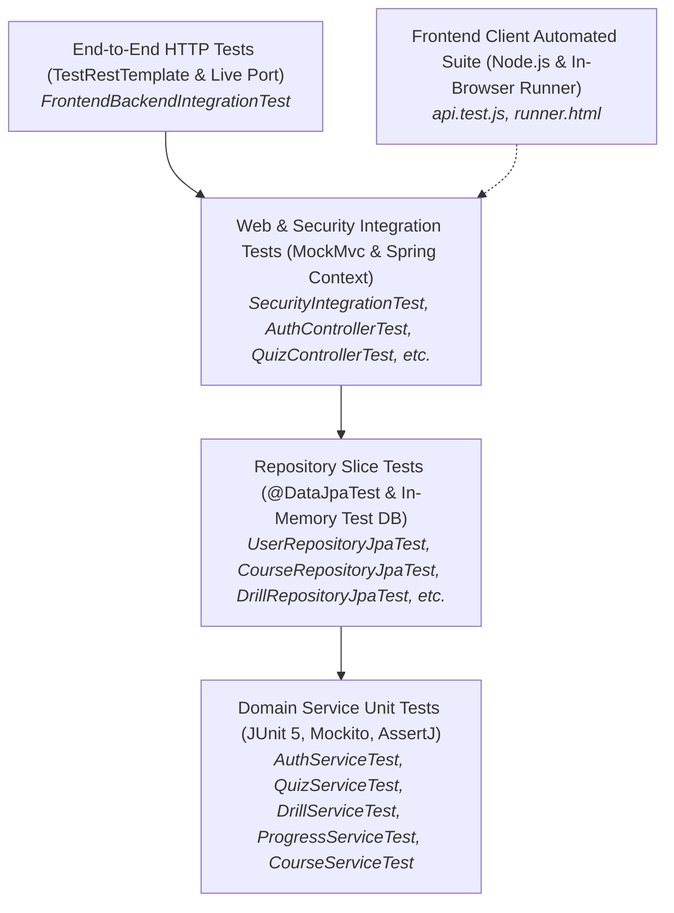

# Suraksha Platform — Comprehensive Testing & Reliability Guide (Milestone 9)

---

## 📌 1. Overview & Testing Philosophy

Reliability in a disaster preparedness learning platform is critical: students and teachers rely on the accuracy of safety instructions, deterministic scoring, authenticated progress records, and resilient services.

Milestone 9 introduces a comprehensive multi-layered **Testing Pyramid** designed to verify functionality at every boundary—from isolated Java domain services to database schema integrity, web security filters, real HTTP network pipelines, and frontend API client interactions.



---

## 🏗️ 2. The Multi-Layered Test Pyramid

| Test Layer | Frameworks & Tools | Scope & Purpose | Speed | Total Tests |
| :--- | :--- | :--- | :--- | :---: |
| **Domain Service Unit Tests** | JUnit 5, Mockito, AssertJ | Fast business logic verification in complete isolation without starting Spring context or database. Verifies scoring algorithms, pass thresholds, deduplication, rating scales, and password hashing. | ~0.2s–1s | **30 tests** |
| **Repository Slice Tests** | `@DataJpaTest`, Hibernate ORM, Test H2 (MySQL Mode) | Verifies custom JPQL queries, sequence ordering, foreign-key relationships, unique constraints, and cascade behaviors against JPA schema. | ~1.5s–3s | **19 tests** |
| **Security & REST Integration Tests** | `@SpringBootTest`, `@AutoConfigureMockMvc`, Spring Security 6 | Validates HTTP status codes, JSON response envelope (`ApiResponse<T>`), JWT Bearer extraction/rejection, CORS preflight headers, Jakarta validation errors, and cross-user data isolation. | ~5s–8s | **53 tests** |
| **Real HTTP E2E Tests** | `SpringBootTest.WebEnvironment.RANDOM_PORT`, `TestRestTemplate` | Tests live HTTP socket communication on an embedded Tomcat server simulating actual browser fetch traffic. | ~8s | **4 tests** |
| **Frontend Client Tests** | Vanilla JS, Node.js runtime, HTML test runner | Validates `SurakshaApi` client URL resolution, sessionStorage token persistence, Bearer header attachment, response envelope unwrapping, centralized 401 recovery, and DTO structures. | ~0.5s | **14 tests** |
| **Total Automated Tests** | — | **Full platform verification across all layers** | **~1.5 min** | **120 tests** |

---

## 🔍 3. Real Defects Discovered & Security Hardening

During the Milestone 9 inspection and reliability phase, several concrete defects and security risks were identified and resolved:

### 1. Handled Malformed JSON Payloads (`HttpMessageNotReadableException`)
* **Discovery**: Sending unparseable or truncated JSON (e.g., `{ "fullName": "Test", "email": `) to endpoints caused Spring Boot to fall through to the generic unhandled exception handler, returning `HTTP 500 Internal Server Error`.
* **Fix**: Added explicit `@ExceptionHandler(HttpMessageNotReadableException.class)` in [`GlobalExceptionHandler.java`](file:///d:/Projects/Suraksha%20Disaster%20Preparedness%20Project/backend/src/main/java/org/suraksha/exception/GlobalExceptionHandler.java) returning clean `HTTP 400 Bad Request` with message `"Malformed JSON request body or unparseable field values."`.

### 2. Internal Error Leakage Sanitization
* **Discovery**: The generic fallback handler in `GlobalExceptionHandler` previously appended raw `ex.getMessage()` into the JSON response details, risking exposure of SQL error messages, driver classes, or table names to untrusted clients.
* **Fix**: Sanitized the response to return a safe generic message (`"An unexpected internal server error occurred."`) while logging full stack traces internally using SLF4J (`log.error(...)`).

### 3. JPA Identity Column Immediate Execution Behavior
* **Discovery**: When testing unique database constraints (e.g., duplicate course slug or user email), calling `repository.save()` threw `DataIntegrityViolationException` immediately rather than waiting for `entityManager.flush()`.
* **Root Cause**: Entities configured with `@GeneratedValue(strategy = GenerationType.IDENTITY)` cannot delay SQL `INSERT` execution until transaction commit or flush because Hibernate requires the database to generate and return the auto-increment primary key immediately upon `save()`.
* **Fix**: Restructured constraint slice tests to wrap both `repository.save()` and `entityManager.flush()` inside `assertThatThrownBy(...)`.

---

## 📊 4. Test Suite Inventory & Exact Metrics

### Backend Suite: 106 Tests (0 Failures, 0 Errors, 0 Skipped)

```text
[INFO] -------------------------------------------------------
[INFO]  T E S T S   E X E C U T I O N   S U M M A R Y
[INFO] -------------------------------------------------------
[INFO] Running org.suraksha.service.AuthServiceTest                    [6 tests,  PASS]
[INFO] Running org.suraksha.service.CourseServiceTest                  [4 tests,  PASS]
[INFO] Running org.suraksha.service.QuizServiceTest                    [9 tests,  PASS]
[INFO] Running org.suraksha.service.DrillServiceTest                   [7 tests,  PASS]
[INFO] Running org.suraksha.service.ProgressServiceTest                [3 tests,  PASS]
[INFO] Running org.suraksha.service.ContactServiceTest                 [1 test,   PASS]
[INFO] Running org.suraksha.JwtServiceTest                             [6 tests,  PASS]
[INFO] Running org.suraksha.repository.UserRepositoryJpaTest           [3 tests,  PASS]
[INFO] Running org.suraksha.repository.CourseRepositoryJpaTest         [4 tests,  PASS]
[INFO] Running org.suraksha.repository.QuizRepositoryJpaTest           [4 tests,  PASS]
[INFO] Running org.suraksha.repository.DrillRepositoryJpaTest          [4 tests,  PASS]
[INFO] Running org.suraksha.repository.UserLessonProgressRepository... [4 tests,  PASS]
[INFO] Running org.suraksha.SecurityIntegrationTest                    [13 tests, PASS]
[INFO] Running org.suraksha.AuthControllerTest                         [12 tests, PASS]
[INFO] Running org.suraksha.CourseControllerTest                       [8 tests,  PASS]
[INFO] Running org.suraksha.QuizControllerTest                         [7 tests,  PASS]
[INFO] Running org.suraksha.DrillControllerTest                        [6 tests,  PASS]
[INFO] Running org.suraksha.ProgressControllerTest                     [5 tests,  PASS]
[INFO] Running org.suraksha.ContactControllerTest                      [3 tests,  PASS]
[INFO] Running org.suraksha.HealthControllerTest                       [2 tests,  PASS]
[INFO] Running org.suraksha.RepositoryTests                            [3 tests,  PASS]
[INFO] Running org.suraksha.SurakshaApplicationTests                   [1 test,   PASS]
[INFO] Running org.suraksha.FrontendBackendIntegrationTest             [1 test,   PASS]
[INFO] 
[INFO] Results: Tests run: 106, Failures: 0, Errors: 0, Skipped: 0
[INFO] BUILD SUCCESS (Total time: 01:36 min)
```

### Frontend Client Suite: 14 Tests (0 Failures)

```text
=== Suraksha Frontend API Client Tests ===
  [PASS] Base URL defaults to http://localhost:8080/api
  [PASS] setBaseUrl overrides URL and strips trailing slashes
  [PASS] window.SURAKSHA_API_BASE takes precedence over storage
  [PASS] Token management via SurakshaApi and SurakshaApi.auth
  [PASS] User management: setUser stores JSON and getUser parses correctly
  [PASS] getUser handles corrupted JSON safely without throwing
  [PASS] request() attaches Authorization Bearer header when token is present
  [PASS] request() does NOT attach Authorization header when token is absent
  [PASS] request() unwrap envelope: returns 'data' from { success: true, data: ... }
  [PASS] request() throws error on HTTP 400 Bad Request with backend message and details
  [PASS] request() on 401 Unauthorized clears token and fires auth-changed event
  [PASS] request() converts network failures into clean error with isNetworkError flag
  [PASS] DTO verification: submitQuiz sends { answers: [...] } structure
  [PASS] DTO verification: submitDrill sends { selectedChoiceIds: [...] } structure

Frontend Test Summary: 14 passed, 0 failed
```

---

## ⚙️ 5. How to Run the Tests

### 1. Running the Complete Backend Suite
Open a terminal in `backend/` and run:
```bash
mvn clean test
```

### 2. Running a Specific Test Class
```bash
# Run Security and Authorization integration tests
mvn test -Dtest=SecurityIntegrationTest

# Run Service unit tests only
mvn test -Dtest=*ServiceTest

# Run JPA Repository slice tests only
mvn test -Dtest=*JpaTest
```

### 3. Running the Frontend Automated Tests
In the project root directory:
```bash
node frontend/test/api.test.js
```

### 4. Running Tests in a Web Browser
Open `frontend/test/runner.html` in Chrome, Edge, or Firefox. The test runner will execute all test assertions and render an interactive test report with pass/fail badges.

---

## 🗄️ 6. MySQL Service Status & Honest Connectivity Report

* **Service Status**: The local MySQL service (`MySQL80`) is **Running** on port `3306`.
* **Testing Profile**: The automated test suite executes against Spring Boot's test profile (`src/test/resources/application-test.yml`), which uses an in-memory H2 database configured in MySQL compatibility mode:
  ```yaml
  spring:
    datasource:
      url: jdbc:h2:mem:suraksha_test_db;MODE=MySQL;DATABASE_TO_LOWER=TRUE;DB_CLOSE_DELAY=-1
  ```
* **Honest Rationale**:
  - In-memory H2 ensures tests are **hermetic, idempotent, and fast** without requiring pre-seeded local database credentials or risking destructive schema drops on shared developer environments.
  - While H2 verifies JPA entity mappings, constraints, and JPQL queries, it **does not replace live MySQL integration testing**. Connecting to the live MySQL instance requires explicit environment credentials (`DB_PASSWORD`). The production deployment pipeline should include a dedicated staging integration pass against a genuine MySQL 8.0 instance before public release.

---

## 💡 7. Technical Interview Preparation (Q&A)

### Q1: What is the testing pyramid, and how is it implemented in Suraksha?
> **Answer**: The testing pyramid is an architectural testing strategy that balances test speed, isolation, and confidence. At the base, we have 30 fast **unit tests** (`AuthServiceTest`, `QuizServiceTest`) using Mockito to test isolated business algorithms (rounding, pass threshold logic, deduplication). In the middle, 19 **repository slice tests** (`@DataJpaTest`) verify JPA queries and database constraints without booting the full web layer. At the top, 53 **MockMvc integration tests** and real HTTP end-to-end tests verify Spring Security filter chains, JWT validation, and HTTP endpoints. This ensures fast developer feedback loops while guaranteeing system-wide reliability.

### Q2: Why did we test repository queries with `@DataJpaTest` instead of mocking repositories in every test?
> **Answer**: Mocking repositories (`when(repo.findByEmail(...)).thenReturn(...)`) only tests what our code does *assuming* the query works; it cannot detect SQL syntax errors, invalid JPQL joins, broken unique constraints, or missing `@Column` mappings. `@DataJpaTest` configures an actual Hibernate Session and an in-memory SQL database, enabling real query compilation, constraint enforcement, and sequence ordering verification.

### Q3: Why does `@GeneratedValue(strategy = GenerationType.IDENTITY)` cause immediate SQL execution on `save()`?
> **Answer**: Under `IDENTITY` generation, primary key values are assigned by MySQL's auto-increment counter upon insertion. Because Hibernate must assign a non-null ID to the entity immediately to maintain identity semantics in the persistence context, it cannot delay the `INSERT` statement until the transaction commit or flush. Consequently, unique constraint violations occur right during `repository.save()`.

### Q4: How does `@Transactional` on integration test classes prevent data contamination?
> **Answer**: When an integration test class or method is annotated with Spring's `@Transactional`, Spring begins a transaction before each test method and automatically issues a rollback at the end of the test. This guarantees that entities saved or modified during one test do not leak into subsequent tests, preserving test idempotency.

### Q5: How do we prevent Cross-User Insecure Direct Object References (IDOR) and verify it in tests?
> **Answer**: In Suraksha, progress and attempt endpoints do not accept a `userId` in the request body or path. Instead, the controller extracts the authenticated user directly from the Spring Security `Authentication` principal (`UserDetails`). In `SecurityIntegrationTest.testCrossUserDataIsolation`, we explicitly authenticate as Alice, mark a lesson complete, and verify that Bob's progress query returns 0 completed lessons, proving complete cross-user data isolation.

### Q6: Why must security error responses avoid leaking internal exception details?
> **Answer**: Revealing internal error messages (such as `com.mysql.cj.jdbc.exceptions.MySQLSyntaxErrorException` or unhandled class cast exceptions) aids attackers by disclosing internal table structures, framework versions, and database schemas. In Suraksha, `GlobalExceptionHandler` logs technical details internally via SLF4J and returns sanitized, predictable error JSON envelopes (`ApiResponse<T>`) to the client.
